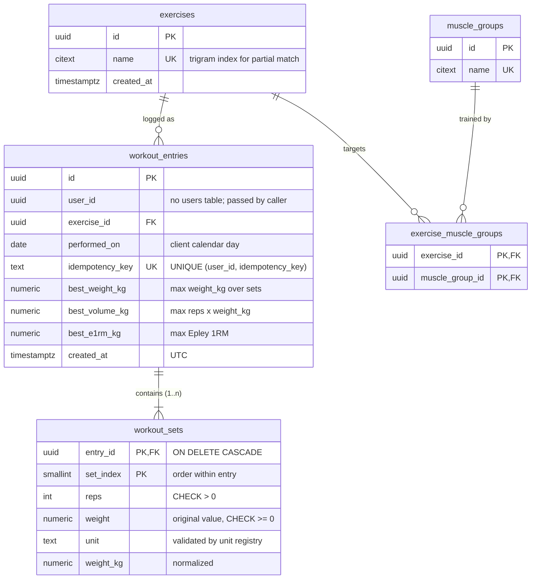

# ADR 0001: Database Selection — PostgreSQL vs MongoDB

- **Status:** Accepted
- **Date:** 2026-10-15
- **Deciders:** Project owner (with AI-assisted analysis)

## Summary

**Decision:** PostgreSQL.

**Why:** Both PostgreSQL and MongoDB can meet the performance requirements. The difference is where complexity lives. PostgreSQL keeps aggregation, filtering and the configurable muscle-group mapping simple, and puts the extra work on the write path. The assignment evaluates aggregation efficiency and configurable mapping explicitly, so that trade-off fits best.

**Schema at a glance:**
- `workout_entries`: one row per logged exercise session for a user; several entries per exercise per day are allowed ([ADR 0003](0003-concurrent-writes-and-idempotency.md)). It holds per-entry PR summaries computed when the entry is written: `best_weight_kg`, `best_volume_kg`, `best_e1rm_kg`.
- `workout_sets`: child rows of an entry. Each keeps the original `weight` and `unit` plus the normalized `weight_kg`.
- `exercises`, `muscle_groups`, `exercise_muscle_groups`: the configurable exercise → muscle group mapping, stored as data.



Key indexes:
- `workout_entries (user_id, performed_on DESC, created_at DESC, id DESC)`: history and cursor pagination, in the order ADR 0002 defines
- `workout_entries (user_id, exercise_id, performed_on)`: PR range comparisons and history filtered by exercise
- `workout_entries (user_id, exercise_id, best_weight_kg DESC, performed_on)`, and the same for `best_volume_kg` and `best_e1rm_kg`: PR lookups; the trailing `performed_on` dates a tied record by the first time it was reached
- `workout_sets PRIMARY KEY (entry_id, set_index)`: loading an entry's sets; sets are never addressed on their own, so there is no surrogate id
- `exercise_muscle_groups (muscle_group_id)`: resolving the muscle-group filter to exercise ids
- `exercises USING gin ((name::text) gin_trgm_ops)`: partial name match; `citext` has no trigram operator class, so the index is on the text cast

**How it meets the 50k+ entries per user requirement:**
- PR lookups and range comparisons read the per-entry summaries, not every set. That is about 5× fewer rows and smaller indexes.
- History uses cursor (keyset) pagination on `(user_id, performed_on DESC, created_at DESC, id DESC)`.
- Exercise-name and muscle-group filters are first resolved to exercise ids using the small `exercises` table and the `exercise_muscle_groups` mapping, then applied to an indexed scan of the user's entries.

**Integrity and concurrency:**
- `CHECK` constraints and foreign keys enforce data rules in the database.
- Each bulk request is written in one transaction.
- Retries are idempotent via `UNIQUE (user_id, idempotency_key)` with `ON CONFLICT`. See [ADR 0003](0003-concurrent-writes-and-idempotency.md).

**Key trade-offs accepted:**
- Entries are immutable after creation, so the summaries never go stale.
- Changing the 1RM formula requires a backfill.
- History responses must reassemble each entry with its sets.
- `unit` is `TEXT` validated by a unit registry in code, so adding a unit like stone needs no migration.
- Weights and summaries are `NUMERIC(10,3)` (volume `NUMERIC(14,3)`, e1RM `NUMERIC(12,3)`): gram precision, computed with exact decimals in the API.
- Entry ids are generated by the API, so a bulk request inserts all entries and all sets with one multi-row statement each.

> The detailed sections below record the original analysis. The detailed Option A section is superseded by this Summary: per-entry summaries on `workout_entries`, and no denormalized columns on `workout_sets`.

## Context

The Workout Logging API lets coaches log client workouts and query history and personal records (PRs). The assignment allows either MongoDB or PostgreSQL, but the choice must be justified along with the schema and indexing strategy.

The requirements that shape the storage layer:

| Requirement | Storage implication |
|---|---|
| Log entries: `userId`, `date`, `exerciseName`, `sets[{reps, weight, unit}]`; bulk logging | Write shape is "entry with nested sets"; several entries are created atomically per request |
| Store the original weight and the normalized kg value | Two weight representations per set; decimal precision matters |
| History filtered by partial exercise name, date range, muscle group; paginated | Indexed range scans per user; partial-text match; a join or lookup to exercise metadata |
| PRs per user and exercise: max weight, max set volume, best Epley 1RM, each with its date | Per-set metrics must be queryable without scanning all of a user's data |
| Compare PRs across time ranges (this month vs last month) | Conditional aggregation over date ranges |
| Concurrent writes (same user, same exercise, same time) | Idempotency and atomic multi-row writes; see [ADR 0003](0003-concurrent-writes-and-idempotency.md) |
| 50,000+ entries per user must perform well | Every read path must be index-backed; no full per-user scans |
| Exercise → muscle group mapping must be configurable | The mapping is data, not code; changes should take effect without rewriting history |
| Adding a unit (e.g. stone) needs minimal code change | Unit should not be hard-baked into the schema as a closed type that requires migrations |

## Decision Drivers

1. Aggregation query efficiency. The reviewers evaluate this explicitly.
2. Index-backed PR lookups at 50k+ entries per user.
3. A configurable muscle-group mapping that applies immediately, without backfills.
4. Integrity enforced at the storage boundary (non-negative weight/reps, non-empty sets).
5. Safe concurrent and bulk writes.
6. Simple local setup (`docker compose up`).

## Considered Options

### Option A: PostgreSQL

Normalized relational schema with one row per set. Per-set metrics are computed at write time.

```sql
exercises              (id, name CITEXT UNIQUE, created_at)
muscle_groups          (id, name UNIQUE)
exercise_muscle_groups (exercise_id, muscle_group_id, PRIMARY KEY (exercise_id, muscle_group_id))

workout_entries (
  id UUID PK, user_id UUID, exercise_id FK, performed_on DATE,
  idempotency_key TEXT, created_at TIMESTAMPTZ,
  UNIQUE (user_id, idempotency_key)
)

workout_sets (
  id UUID PK, entry_id FK ON DELETE CASCADE, set_index SMALLINT,
  reps INT CHECK (reps > 0), weight NUMERIC CHECK (weight >= 0), unit TEXT,
  weight_kg NUMERIC, volume_kg NUMERIC, e1rm_kg NUMERIC,
  -- denormalized from the entry so PR queries need no join:
  user_id UUID, exercise_id UUID, performed_on DATE
)
```

Key indexes:

- `workout_entries (user_id, performed_on DESC, id)`: history and keyset pagination
- `workout_sets (user_id, exercise_id, weight_kg DESC)`, and the same for `volume_kg` and `e1rm_kg`: one index-only lookup per PR metric
- `workout_sets (user_id, exercise_id, performed_on)`: PR comparison across ranges
- `exercises USING gin (name gin_trgm_ops)`: partial name match

**Pros**
- PR comparison across ranges is a single SQL query using `FILTER (WHERE performed_on BETWEEN …)` or `DISTINCT ON`. Trend and bucketing queries stay short.
- Muscle-group filtering is a join against config tables. Changing the mapping takes effect immediately for all historical data.
- `CHECK` constraints, foreign keys and transactions enforce integrity in the database, not only in application code.
- `NUMERIC` avoids floating-point drift in unit conversion.
- Bulk logging is one transaction with multi-row inserts. Idempotent retries use `ON CONFLICT (user_id, idempotency_key)`.
- Runs as a single container with no extra setup.

**Cons**
- The write shape (entry with nested sets) is split across two tables. Reads must reassemble it with a join or `json_agg`.
- Denormalized columns on `workout_sets` must be kept consistent with the parent entry. This is mitigated because entries are immutable after creation, or by updating them in the same transaction.
- Requires a migration tool (TypeORM, Prisma or Knex migrations).

### Option B: MongoDB

One document per entry with embedded sets. PR metrics for each entry are computed at write time.

```js
workout_entries {
  _id, userId, exerciseId, exerciseName,
  performedOn: ISODate,                        // calendar day at 00:00Z
  sets: [{ reps, weight, unit, weightKg, volumeKg, e1rmKg }],
  best: { weightKg, volumeKg, e1rmKg },        // max over sets, computed when written
  idempotencyKey, createdAt
}
exercises { _id, name, muscleGroups: [...] }
```

Key indexes:

- `{ userId: 1, performedOn: -1, _id: -1 }`: history and pagination
- `{ userId: 1, exerciseId: 1, "best.weightKg": -1 }`, and the same for `volumeKg` and `e1rmKg`: PR lookups
- `{ userId: 1, idempotencyKey: 1 }`, unique and partial: idempotent writes

**Pros**
- The document matches the API request and response shape. Writes and history reads involve no joins.
- Bulk logging maps to `insertMany`.
- The schema is flexible, so new optional fields need no migrations.
- With `best.*` precomputed, PR lookups are indexed sorts with a limit of 1, as fast as Option A.
- Possibly aligned with Everfit's production stack (unverified).

**Cons**
- Precomputing `best.*` is required for performance. If it is missed, PR queries fall back to `$unwind` over every set.
- The muscle-group filter needs either a two-step query (look up exercise ids, then `$in`) or denormalized `muscleGroups` on entries. The latter needs a backfill whenever the mapping changes, which undermines "configurable".
- Range comparison and trend queries need more verbose aggregation pipelines (`$facet`, `$group`).
- Validation via `$jsonSchema` is weaker than `CHECK` constraints and foreign keys, so more integrity lives in application code.
- Multi-document transactions for atomic bulk writes require a replica set, even in local Docker.
- Decimal precision requires `Decimal128`, which is awkward in the Node driver. Plain doubles are easier but less exact.

## Decision

**Accepted: Option A, PostgreSQL.**

Both options can meet the performance requirements once metrics are computed at write time. The difference is where complexity lives:

- **PostgreSQL** puts it on the write path (split into tables, denormalized set columns). Aggregation, filtering and configurable mapping stay simple and flexible.
- **MongoDB** keeps writes and history reads simple. It moves complexity into PR precomputation, mapping backfills and aggregation pipelines.

The assignment weights aggregation efficiency and configurable muscle-group mapping explicitly, so PostgreSQL's trade-offs fit the evaluated criteria better. This is a moderate preference, not a hard requirement. Option B remains acceptable if stack alignment with the team outweighs these factors.

## Consequences

**Positive**
- Every PR metric is answered by a dedicated index. Cost stays roughly constant as a user's history grows past 50k entries.
- Muscle-group mapping is managed as data (seeded config tables) with no changes to business logic.
- Integrity rules are enforced in two layers: DTO validation at the API and constraints in the database.

**Negative / follow-ups**
- A repository layer must reassemble the entry-with-sets shape for history responses.
- Entries are treated as immutable after creation, so denormalized set columns cannot drift. If edits are added later, they must update sets in the same transaction.
- `unit` is stored as `TEXT` validated by a unit registry in code, not a Postgres enum. Adding "stone" then needs no migration.
- Out of scope for this ADR: timezone strategy (see [ADR 0002](0002-workout-date-and-timezone.md)) and the pagination scheme.

## Revisit If

- Everfit's team confirms a MongoDB-only stack, and operational alignment outweighs the factors above.
- Write volume grows to the point where per-set rows and multiple indexes become a write-throughput bottleneck. Options then: partition by `user_id`, or use a rollup table for PRs.
