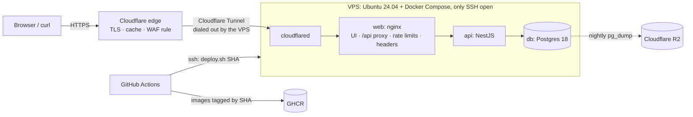

# Deployment

The demo runs at **https://workout.albertnguyen.dev**: the UI at `/` and the API at `/api/*` (`curl https://workout.albertnguyen.dev/api/exercises`). [ADR 0005](adr/0005-single-vps-behind-cloudflare-tunnel.md) explains the design.



| File | Where it runs | What it does |
| --- | --- | --- |
| `deploy/cloud-init.yaml` | The VPS, at first boot | User `deploy`, SSH hardening, ufw, Docker, swap, the backup timer |
| `deploy/compose.yaml` | `/opt/workout/compose.yaml` | The production stack; no service publishes a port |
| `deploy/deploy.sh` | `/opt/workout/` | Switches `IMAGE_TAG`, waits for the health checks, rolls back on failure |
| `deploy/backup.sh`, `restore.sh`, `r2-env.sh` | `/opt/workout/` | The nightly dump to R2; restoring a dump |
| `deploy/test-deploy.sh` | CI and your machine | Rehearses deploy, rollback, and backup and restore with the production Compose file |
| `scripts/smoke-test.sh` | CI and after each deploy | Checks the UI, the API proxy, the headers and the error formats |
| `.github/workflows/ci.yml` | Every pull request | Lint, types, unit and e2e tests, the Docker stack, the deploy rehearsal |
| `.github/workflows/deploy.yml` | Every push to `main`, or by hand | CI, the image build to GHCR, the deploy, a smoke test |

Every deploy copies `compose.yaml` and the scripts to the server, so the server can't drift from `main`. Only `/opt/workout/.env` is edited by hand.

## One-time setup

### 1. SSH keys

Log in with your own key. GitHub Actions gets a separate key of its own:

```bash
ssh-keygen -t ed25519 -f ~/.ssh/workout-deploy -N '' -C github-actions-deploy
```

### 2. The server

Create an x86_64 VPS with Ubuntu 24.04 LTS, 2 vCPU and 2–4 GB of RAM, in Singapore (the closest region to Vietnam). For example: a DigitalOcean droplet, a Hetzner Cloud server in `sin`, or an AWS Lightsail instance. Turn on the provider's weekly snapshots as a second backup. Fill in the two public keys, then give the result to the provider as the server's user data (cloud-init):

```bash
sed -e "s|REPLACE_WITH_YOUR_PUBLIC_KEY|$(cat ~/.ssh/id_ed25519.pub)|" \
    -e "s|REPLACE_WITH_CI_PUBLIC_KEY|$(cat ~/.ssh/workout-deploy.pub)|" \
    deploy/cloud-init.yaml > /tmp/workout-user-data.yaml
grep REPLACE_WITH /tmp/workout-user-data.yaml && echo 'A key is missing: fix it before creating the server'
```

When the server is up, check that the setup finished:

```bash
ssh deploy@<server IP>
cloud-init status --wait                     # status: done
docker compose version                       # Docker Compose version v5.x
sudo ufw status                              # 22/tcp (OpenSSH) ALLOW, nothing else
docker info --format '{{.LoggingDriver}}'    # local
systemctl list-timers workout-backup.timer   # next run at 03:00 UTC
```

Root logins and passwords are off. Log in as `deploy`, which can use `sudo`.

### 3. The Cloudflare Tunnel

1. In the Cloudflare dashboard, open **Zero Trust → Networks → Tunnels** and create a tunnel of type **Cloudflared** named `workout`.
2. Skip the connector installation, but copy the token from the install command it shows (the long string after the `install` or `--token` argument). It goes into `.env` as `TUNNEL_TOKEN`.
3. Add a **public hostname**: subdomain `workout`, domain `albertnguyen.dev`, service type `HTTP`, URL `web:80`. Cloudflare creates the proxied DNS record itself. Universal SSL already covers `workout.albertnguyen.dev`.

### 4. Cloudflare settings for albertnguyen.dev

- **SSL/TLS → Edge Certificates:** Always Use HTTPS on, and Minimum TLS Version 1.2.
- **Security → WAF → Rate limiting rules:** add one rule. When *URI Path* *starts with* `/api/`, count requests per IP; above **100 in 10 seconds**, **Block** for 10 seconds. nginx's tighter per-client limits sit behind it.
- **Caching → Cache Rules:** add a rule. When *URI Path* *starts with* `/api/`, **Bypass cache**.
- **Security → Bots:** Bot Fight Mode **off**. It challenges curl and other API clients.
- **Speed:** Rocket Loader **off**, and don't turn on automatic Web Analytics injection. Both add scripts that the Content Security Policy blocks.

### 5. R2 for backups

1. **R2 → Create bucket** named `workout-backups`, with the location hint Asia-Pacific.
2. In the bucket's **Settings → Object lifecycle rules**, add a rule that deletes objects 14 days after upload.
3. **R2 → Manage API tokens → Create API token**, with the permission *Object Read & Write*, applied to `workout-backups` only. Note the Access Key ID, the Secret Access Key, and your account ID, which is part of the S3 endpoint `https://<account id>.r2.cloudflarestorage.com`.
4. Optional: create a check at https://healthchecks.io (period 1 day, grace 2 hours) and keep its ping URL. If a night's backup doesn't report in, it emails you.

### 6. The server's `.env`

```bash
ssh deploy@<server IP>
cd /opt/workout
nano .env      # paste deploy/.env.example from the repo, then fill it in
chmod 600 .env
```

Generate the database password with `openssl rand -hex 32`. Write every value without quotes or spaces: `deploy.sh` rewrites `IMAGE_TAG`, and the backup scripts read the file with the shell. Leave `IMAGE_TAG` empty; the first deploy sets it. Postgres reads `POSTGRES_PASSWORD` only when the database volume is first created. Changing it later is a rotation (see below), not an edit.

### 7. GitHub

Add four repository secrets:

```bash
gh secret set DEPLOY_HOST --body '<server IP>'
gh secret set DEPLOY_USER --body deploy
gh secret set DEPLOY_SSH_KEY < ~/.ssh/workout-deploy
ssh-keyscan -t ed25519 <server IP> | gh secret set DEPLOY_KNOWN_HOSTS
```

`DEPLOY_KNOWN_HOSTS` pins the server's host key. Compare the output of `ssh-keyscan -t ed25519 <server IP> | ssh-keygen -lf -` with the fingerprint your first `ssh` login accepted.

The deploy workflow logs Docker on the server into GHCR with the workflow's own short-lived `GITHUB_TOKEN`, and logs out when the deploy finishes. The server keeps no registry credentials.

### 8. Uptime monitoring

Create a free HTTP monitor (UptimeRobot or Better Stack) for `https://workout.albertnguyen.dev/api/health`, checking every 5 minutes and alerting by email. That endpoint checks the database too.

### 9. First deploy

Merge to `main`. The **Deploy** workflow runs CI, builds `ghcr.io/anhntt96/workout-api:<sha>` and `workout-web:<sha>`, deploys them, and smoke-tests the public URL. Follow it with `gh run watch`.

## Operations

Unless a command says otherwise, run it on the server in `/opt/workout` as `deploy`.

### Deploy

Push or merge to `main`. During a deploy the API container restarts, and requests get JSON `503`s for a few seconds. If the new release isn't healthy within 3 minutes, `deploy.sh` puts the previous release back and the workflow fails, with the API's last 50 log lines in its log.

Migrations run when the API starts. Keep each one compatible with the previous release: add columns and tables now, and drop them a release later. A rollback runs the old code on the new schema.

### Roll back

From your machine, redeploy an earlier commit's images:

```bash
gh workflow run deploy.yml -f image_tag=<full commit SHA>
```

This skips CI and the image build, so the commit must have been built by an earlier deploy. The run uses `main`'s current `compose.yaml` and scripts.

### Logs

```bash
docker compose ps
docker compose logs -f api                    # pino JSON, one line per request
docker compose logs api | grep <request id>   # every API error response carries its requestId
docker compose logs --since 1h web cloudflared
```

Docker rotates the logs: 5 files of 20 MB per container.

### Backups and restore

```bash
sudo systemctl start workout-backup.service   # back up now
journalctl -u workout-backup.service -n 20     # shows "Uploaded workout-….dump to r2:workout-backups"
./restore.sh --list
```

To check a dump, restore it into a scratch database:

```bash
docker compose exec -T db createdb --username workout restore_check
./restore.sh workout-20261017T030000Z.dump restore_check
docker compose exec -T db psql --username workout --dbname restore_check -c 'SELECT count(*) FROM workout_entries'
docker compose exec -T db dropdb --username workout restore_check
```

To restore over the live database, replacing its contents:

```bash
docker compose stop api
./restore.sh workout-20261017T030000Z.dump
docker compose start api
```

### Reset the demo data

```bash
docker compose exec -T db psql --username workout --dbname workout -c 'TRUNCATE workout_sets, workout_entries'
```

The exercise catalog stays.

### Update Postgres or cloudflared

- Postgres patch releases: `docker compose pull db && docker compose up -d --wait db`. A new major version needs a dump and a restore.
- cloudflared: change its tag in `deploy/compose.yaml` and merge. The next deploy pulls it.

### Rotate the database password

```bash
new=$(openssl rand -hex 32)
docker compose exec -T db psql --username workout --dbname workout -c "ALTER ROLE workout PASSWORD '$new'"
sed -i "s/^POSTGRES_PASSWORD=.*/POSTGRES_PASSWORD=$new/" .env
docker compose up -d --wait api
```

## Troubleshooting

| Symptom | What to check |
| --- | --- |
| Cloudflare error 1033, or Cloudflare's own 502 page | The tunnel is down: `docker compose logs cloudflared`. Check `TUNNEL_TOKEN`, then run `docker compose up -d cloudflared`. |
| JSON `503` "The API is unavailable right now" | nginx can't reach the API: `docker compose ps` and `docker compose logs api`. |
| JSON `503` "Database is unreachable" | The API is up but Postgres isn't: `docker compose logs db` and `df -h`. |
| JSON `429` | nginx's per-client limit: 20 writes a minute, 20 requests a second. An HTML `429` from Cloudflare comes from the WAF rule instead. |
| A deploy failed and rolled back | The workflow log shows the API's last log lines. Reproduce locally with `docker compose up --build` on that commit. |
| The disk is filling up | `docker system df`. `deploy.sh` removes this app's unused images after a week. |
