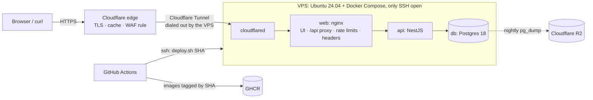

# Production Deployment Implementation Plan

> **For agentic workers:** REQUIRED SUB-SKILL: Use superpowers:subagent-driven-development (recommended) or superpowers:executing-plans to implement this plan task-by-task. Steps use checkbox (`- [ ]`) syntax for tracking.

**Goal:** Serve the Workout Log UI and API at `https://workout.albertnguyen.dev` from one VPS behind a Cloudflare Tunnel. GitHub Actions deploys it, and it has rate limits, security headers, automatic rollback and daily off-site backups.

**Architecture:** The VPS runs a production Compose file: Postgres, the API, nginx (the UI and the `/api` proxy) and `cloudflared`. No service publishes a port. Cloudflare provides DNS, TLS, the edge cache and a WAF rule, and sends traffic through the tunnel. GitHub Actions tests each change, builds images tagged with the commit SHA into GHCR, and deploys them over SSH with `deploy.sh`, which rolls back an unhealthy release. A systemd timer dumps Postgres to Cloudflare R2 every night.

**Tech Stack:** Docker Compose v5, nginx 1.30, cloudflared 2026.9.3, Postgres 18, Node 24, GitHub Actions, GHCR, Cloudflare (DNS, Tunnel, WAF, R2), Ubuntu 24.04 with cloud-init, rclone, bash.

**Spec:** There is no separate spec file. The **Design** section below and ADR 0005 (Task 1) hold the decisions, and the tasks argue from them.

**Not yet executed:** this plan was written in plan mode, so none of its code has been run. Each task's test step is the first real run. Fix small slips there (nginx syntax, Compose flags) and keep the tests as written.

## Design

### Decisions (made with the project owner)

- **Hosting:** one VPS running Compose, with a Cloudflare Tunnel (outbound only). The alternatives were a PaaS with managed Postgres, and AWS ECS with RDS.
- **Exposure:** a public demo without auth (the brief says so), protected by rate limits. Its data may be reset.
- **Deploys:** GitHub Actions on every push to `main`, plus a manual rollback to any earlier SHA.
- **Hostname:** `workout.albertnguyen.dev`. The UI is at `/` and the API at `/api/*`, on the same origin, so there is no CORS.

### Facts that shaped it

- `albertnguyen.dev` uses **Cloudflare** nameservers (`julissa`/`patryk.ns.cloudflare.com`), and the apex has no record. Universal SSL covers `*.albertnguyen.dev`, which is one level deep, so a deeper name like `api.workout.…` would not be covered.
- The repo `anhntt96/workout_api_log` is **private**. GHCR images are therefore private too, and the server pulls with the workflow's short-lived `GITHUB_TOKEN`.
- There is no CI yet. The backend checks are `lint`, `typecheck`, `format:check`, `test`, `build` and `test:e2e` (Testcontainers). The frontend runs the same set except `test:e2e`.
- "Load sample data" is **one** POST. `scripts/demo.sh` sends about 11 POSTs.
- Today nginx answers some errors with **HTML**: `413` above its default 1 MB body limit, and `502`/`504` while the API restarts. The frontend's `ApiError` only shows a generic message for those.
- The API's error shape is `{ statusCode, code, message, errors?, requestId? }`. The codes come from `src/common/errors/all-exceptions.filter.ts` (`PAYLOAD_TOO_LARGE`, `SERVICE_UNAVAILABLE`, and so on).

### Topology

```
Browser / curl ──HTTPS──► Cloudflare edge (TLS, caches /assets, WAF rate rule)
                              │ Cloudflare Tunnel (the VPS dials out; no inbound HTTP)
VPS ── cloudflared ──► web: nginx (UI, /api proxy, per-client limits, headers, JSON errors) ──► api ──► db
         only SSH open (key-only)                                      nightly pg_dump ──► R2 (14 days)
GitHub Actions ── build ──► GHCR (tag = commit SHA) ── ssh deploy.sh <sha> ──► VPS
```

### Out of scope

Authentication, multiple instances, zero-downtime deploys, managed Postgres, Terraform for Cloudflare, and SSH through the tunnel. ADR 0005's "Revisit If" covers them.

## Global Constraints

- The hostname is `workout.albertnguyen.dev`, with the UI at `/` and the API at `/api/*`. Cloudflare handles DNS, TLS and the edge. No AWS.
- `deploy/compose.yaml` must never contain `ports:`. Only `deploy/compose.rehearsal.yaml`, which is used in tests, publishes `127.0.0.1:8081`.
- The images are `ghcr.io/anhntt96/workout-api` and `ghcr.io/anhntt96/workout-web`, tagged with the full commit SHA, `linux/amd64`, and labeled `org.opencontainers.image.source=https://github.com/anhntt96/workout_api_log`.
- Pinned versions: `cloudflare/cloudflared:2026.9.3`, `actions/checkout@v7`, `actions/setup-node@v7`, `docker/setup-buildx-action@v4`, `docker/login-action@v4`, `docker/build-push-action@v7`, `rhysd/actionlint:1.7.12`, `koalaman/shellcheck:v0.11.0`, `postgres:18-alpine`, Node 24, `nginx:1.30-alpine`.
- nginx limits each client, keyed by `CF-Connecting-IP` and falling back to the peer address: `/api/` at 20 r/s with burst 40, and POSTs at 20 r/min with burst 20. A `429` body is `{"statusCode":429,"code":"TOO_MANY_REQUESTS","message":"Too many requests. Try again in a few seconds."}` with `Retry-After: 10`.
- When nginx can't reach the API (502/504), it answers `503` with `{"statusCode":503,"code":"SERVICE_UNAVAILABLE","message":"The API is unavailable right now. Try again in a few seconds."}` and `Retry-After: 5`.
- Every nginx response carries the CSP `default-src 'self'; script-src 'self'; style-src 'self'; img-src 'self' data:; font-src 'self' data:; connect-src 'self'; object-src 'none'; base-uri 'self'; frame-ancestors 'none'; form-action 'self'`, plus `X-Content-Type-Options: nosniff`, `X-Frame-Options: DENY` and `Referrer-Policy: strict-origin-when-cross-origin`.
- Server layout: user `deploy`, directory `/opt/workout`, secrets in `/opt/workout/.env` with mode 600, values without quotes or spaces.
- Backups run daily at 03:00 UTC into the R2 bucket `workout-backups`, which deletes them after 14 days through a lifecycle rule.
- Shell scripts use bash with `set -euo pipefail`. They pass `shellcheck` and run on macOS bash 3.2 and on Ubuntu 24.04, so no `mapfile` and no `${var,,}`.
- Commits use conventional prefixes, and every commit message ends with `Co-Authored-By: Claude Opus 5.5 <noreply@anthropic.com>`. Each ADR gets its own PR. Never stage `AI_WORKFLOW.md`, which a SessionEnd hook edits. PR bodies end with `🤖 Generated with [Claude Code](https://claude.com/claude-code)`.

## Review Focus

1. **The CSP against the real build.** If the Vite build or a library ships inline `<script>` or `<style>`, the live page is blank or unstyled even though every header check passes. *Task 2:* `smoke-test.sh` fails on inline script or style in `index.html`, and Step 8 checks the browser console.
2. **Every visitor in one rate-limit bucket.** If nginx keyed limits on the peer address (cloudflared's), one busy visitor would get everyone `429`s. *Task 2:* `--rate-limit` uses up client `198.51.100.1`'s writes and asserts that client `198.51.100.2` still gets a `400`.
3. **A failed first deploy.** With no previous tag to return to, `deploy.sh` must exit non-zero and leave `IMAGE_TAG` empty, not "roll back" to an empty tag. *Task 3:* `test-deploy.sh` deploys a missing image first.
4. **A malformed rollback tag** typed into the `workflow_dispatch` form. *Task 3:* `test-deploy.sh` passes `main;echo` and asserts a failure with `.env` unchanged.
5. **A backup that can't be restored, or a partial dump uploaded as if it were whole.** *Task 4:* `backup.sh` dumps to a temp file before uploading, and `test-deploy.sh` round-trips a real entry through `backup.sh` and `restore.sh`.

---

## File map

| File | Task | Responsibility |
| --- | --- | --- |
| `docs/adr/0005-single-vps-behind-cloudflare-tunnel.md` | 1 | The decision record |
| `scripts/smoke-test.sh` | 2 | Checks a running stack through its front door (local nginx or production) |
| `frontend/nginx.conf`, `frontend/nginx-security-headers.conf`, `frontend/Dockerfile` | 2 | Rate limits, JSON errors, security headers |
| `deploy/compose.yaml`, `deploy/compose.rehearsal.yaml`, `deploy/.env.example` | 3 | The production stack, a test-only override, and the server secrets template |
| `deploy/deploy.sh`, `deploy/test-deploy.sh` | 3 | Deploy with rollback, and its rehearsal |
| `deploy/r2-env.sh`, `deploy/backup.sh`, `deploy/restore.sh` | 4 | Backups to R2 and restore |
| `deploy/cloud-init.yaml` | 5 | Host provisioning |
| `.github/workflows/ci.yml` | 6 | PR checks, which the deploy workflow reuses |
| `.github/workflows/deploy.yml`, `docs/deployment.md`, `README.md`, `CLAUDE.md` | 7 | Build, deploy and smoke test; the runbook and docs |
| (no repo files) | 8 | Going live: accounts, secrets, drills |

## Before you start

- [ ] Docker Desktop is running (`docker compose version` shows v5.x), and `gh auth status` is logged in.
- [ ] `rclone version` works. If not, run `brew install rclone` (needed from Task 4).
- [ ] `git switch main && git pull --ff-only`. `git status` shows only `AI_WORKFLOW.md` modified. Leave it unstaged throughout.

---

### Task 1: ADR 0005 (its own PR)

**Files:**
- Create: `docs/adr/0005-single-vps-behind-cloudflare-tunnel.md`

**Interfaces:**
- Produces: the ADR path above. README, CLAUDE.md and the runbook link to it.

- [ ] **Step 1: Create the branch**

```bash
git switch -c docs/adr-0005-deployment main
```

- [ ] **Step 2: Write the ADR**

````markdown
# ADR 0005: Deployment on One VPS Behind a Cloudflare Tunnel

- **Status:** Accepted
- **Date:** 2026-10-16
- **Deciders:** Project owner (with AI-assisted analysis)

## Summary

**Decision:** Production is one Linux VPS that runs the Docker Compose stack (Postgres, the API, and nginx with the UI) plus `cloudflared`. Cloudflare serves `workout.albertnguyen.dev`. It handles TLS, caches the hashed assets, applies a WAF rate rule, and sends requests through an outbound-only tunnel. No container publishes a port. GitHub Actions tests every change, builds images tagged with the commit SHA into GHCR, and deploys them over SSH, rolling back automatically if a release isn't healthy. A nightly `pg_dump` goes to Cloudflare R2.

**Why:** The app is a demo for reviewers, with no uptime promise. One VPS costs about $5–12 a month and runs the same Compose stack that the tests and the reviewers already use. The domain's DNS is already on Cloudflare, so TLS, DDoS protection and the tunnel cost nothing. The tunnel also removes inbound HTTP ports and origin certificates.

## Context

- The brief grades production readiness (Docker setup, structured logging, configuration management, performance awareness) and asks for no authentication: `userId` is a parameter.
- `albertnguyen.dev` uses Cloudflare nameservers.
- The UI calls the API only through same-origin `/api/*` (nginx in Docker), so one hostname serves both without CORS.
- Writes are public and unauthenticated, so anyone can add data for any `userId`.

## Options Considered

| Option | Cost per month | For | Against |
| --- | --- | --- | --- |
| **One VPS + Cloudflare Tunnel (chosen)** | ~$5–12 | The same stack as local and CI; no open HTTP ports; TLS, WAF and R2 at no cost | One point of failure; we patch the OS and run the backups |
| PaaS (Fly.io, Render, Railway) + managed Postgres | ~$15–30 | Managed backups and restarts | Platform-specific configuration; the nginx proxy and Compose stack must be reworked for the platform |
| AWS ECS Fargate + RDS + S3/CloudFront | ~$50–80 | Several instances, a managed database, autoscaling | The most setup and cost; the DNS is not on AWS |

## Decision Details

- **Hostname:** `workout.albertnguyen.dev`, with the UI at `/` and the API at `/api/*`. Universal SSL covers one level of subdomain.
- **Path:** Cloudflare edge → tunnel → `cloudflared` → nginx (`web`) → API → Postgres. The VPS firewall allows only SSH, with keys only.
- **Abuse limits:** nginx limits each client, keyed by `CF-Connecting-IP`, to 20 API requests a second (burst 40) and 20 writes a minute (burst 20). It answers `429` in the API's error format. A Cloudflare WAF rule also blocks an IP that sends more than 100 `/api/` requests in 10 seconds.
- **Errors from nginx itself** use the API's `{ statusCode, code, message }` format: `429`, and `503` in place of `502`/`504` while the API restarts.
- **Security headers** come from nginx: a same-origin CSP, `nosniff`, frame denial and a referrer policy. nginx sets no HSTS header, because `.dev` is on the browsers' HSTS preload list.
- **Releases:** the images are `ghcr.io/anhntt96/workout-api` and `workout-web`, tagged with the commit SHA. `deploy.sh` switches `IMAGE_TAG`, waits for the health checks, and puts the previous tag back if the release doesn't become healthy. Migrations still run at API startup under the advisory lock, so each migration must work with the previous release's code.
- **Backups:** a daily `pg_dump -Fc` goes to R2 and is kept 14 days. The restore is tested in CI and on the server.

## Consequences

**Positive**
- One Compose file per environment, and CI tests both: the local stack, and a rehearsal of the production file.
- No public origin for HTTP and no certificates to manage.
- A bad release rolls itself back, and any earlier SHA can be redeployed.

**Negative (accepted)**
- One machine: a VPS outage is an outage, and each deploy restarts the API, giving a few seconds of JSON `503`s.
- The database lives on the VPS disk. The worst case loses up to a day of data, back to the last nightly dump.
- The SSH port is open for CI deploys (keys only, fail2ban).
- Public writes are rate-limited, not authenticated, and the demo data may be reset.

## Testing

- `scripts/smoke-test.sh` checks the UI, the proxy, the headers, the error formats and the rate limits, in CI and after every deploy.
- `deploy/test-deploy.sh` rehearses deploys, rollback, and backup and restore with the production Compose file, in CI.

## Revisit If

- Real users or authentication arrive: move to managed Postgres with point-in-time recovery, and authenticate before rate-limiting.
- Uptime starts to matter: run two or more API instances behind a load balancer, with rolling deploys.
- The open SSH port becomes a concern: deploy through Cloudflare Access for SSH, or a pull-based agent.
````

- [ ] **Step 3: Check the facts in it against the code**

Run: `grep -n "advisory" src/main.ts && grep -n "JSON_BODY_LIMIT = " src/app.setup.ts`
Expected: one line each. These confirm "migrations at startup under the advisory lock" and the 1 MB limit.

- [ ] **Step 4: Commit, push, open the PR**

```bash
git add docs/adr/0005-single-vps-behind-cloudflare-tunnel.md
git commit -m "docs: ADR 0005 deployment on one VPS behind a Cloudflare Tunnel" -m "Co-Authored-By: Claude Opus 5.5 <noreply@anthropic.com>"
git push -u origin docs/adr-0005-deployment
gh pr create --base main --title "docs: ADR 0005 deployment on one VPS behind a Cloudflare Tunnel" \
  --body $'Records the production deployment design: one VPS running Docker Compose behind a Cloudflare Tunnel at workout.albertnguyen.dev, deployed by GitHub Actions with automatic rollback, nightly backups to R2.\n\n🤖 Generated with [Claude Code](https://claude.com/claude-code)'
git switch main
```

---

### Task 2: nginx hardening and the smoke test

**Files:**
- Create: `scripts/smoke-test.sh`
- Create: `frontend/nginx-security-headers.conf`
- Modify: `frontend/nginx.conf` (replace the whole file)
- Modify: `frontend/Dockerfile` (one `COPY` line)

**Interfaces:**
- Produces: `scripts/smoke-test.sh [BASE_URL] [--rate-limit]`, where `BASE_URL` defaults to `http://localhost:8080` and the script exits 0 when every check passes. Tasks 3, 4, 6 and 7 call it. The `--rate-limit` mode sends `CF-Connecting-IP`, so use it only against a local stack.
- Produces: in the `web` image, nginx answers `429` and `503` in the API's error format and sets the security headers on every response.

- [ ] **Step 1: Create the feature branch and commit this plan**

```bash
git switch -c feat/production-deploy main
cp /Users/nguyentientuananh/.claude/plans/i-want-do-deploy-robust-wren.md docs/superpowers/plans/2026-10-16-production-deployment.md
git add docs/superpowers/plans/2026-10-16-production-deployment.md
git commit -m "docs: add the production deployment plan" -m "Co-Authored-By: Claude Opus 5.5 <noreply@anthropic.com>"
```

- [ ] **Step 2: Write the failing smoke test**

Create `scripts/smoke-test.sh`:

```bash
#!/usr/bin/env bash
# Checks a running stack through its front door (nginx, or Cloudflare in front of it): the UI, the /api proxy,
# the security headers, and nginx's own errors in the API's error format. Stores nothing: every POST is invalid.
#
# Usage: scripts/smoke-test.sh [BASE_URL] [--rate-limit]
#   BASE_URL      default http://localhost:8080 (docker compose); production is https://workout.albertnguyen.dev
#   --rate-limit  also bursts POSTs until nginx answers 429. It sends CF-Connecting-IP, which nginx trusts, so
#                 use it only against a local stack: in production Cloudflare replaces that header.
# Needs curl and jq.
set -euo pipefail

BASE_URL=${1:-http://localhost:8080}
MODE=${2:-}
# Any UUID works: the API rejects every POST below before storing anything.
ENTRIES_PATH=/api/users/00000000-0000-4000-8000-000000000000/workout-entries
WORK=$(mktemp -d)
trap 'rm -rf "$WORK"' EXIT

fail() {
  echo "FAIL: $*" >&2
  exit 1
}

# request METHOD PATH [curl args...]: saves the headers and body under $WORK and prints the status code.
request() {
  local method=$1 path=$2
  shift 2
  curl -sS -X "$method" "$BASE_URL$path" -D "$WORK/headers" -o "$WORK/body" -w '%{http_code}' "$@"
}

expect_status() { # expect_status ACTUAL EXPECTED LABEL
  [[ $1 == "$2" ]] || fail "$3: expected HTTP $2, got $1: $(head -c 300 "$WORK/body")"
}

expect_header() { # expect_header NAME VALUE_PREFIX LABEL
  grep -qiF "$1: $2" "$WORK/headers" || fail "$3: no '$1: $2' header"
}

expect_error_code() { # expect_error_code CODE LABEL
  local code
  code=$(jq -r .code "$WORK/body" 2> /dev/null) || fail "$2: the body is not JSON: $(head -c 300 "$WORK/body")"
  [[ $code == "$1" ]] || fail "$2: expected error code $1, got $code"
}

expect_security_headers() { # expect_security_headers LABEL
  expect_header content-security-policy "default-src 'self'" "$1"
  expect_header x-content-type-options nosniff "$1"
  expect_header x-frame-options DENY "$1"
  expect_header referrer-policy strict-origin-when-cross-origin "$1"
}

# 1. The app shell: revalidated on every load, no inline code for the CSP to block, no nginx version.
status=$(request GET /)
expect_status "$status" 200 'GET /'
expect_header cache-control no-cache 'GET /'
expect_security_headers 'GET /'
inline_scripts=$(grep -oE '<script[^>]*>' "$WORK/body" | grep -v ' src=' || true)
[[ -z $inline_scripts ]] || fail "GET /: index.html has an inline script, which the CSP blocks: $inline_scripts"
if grep -qiE '<style|style=' "$WORK/body"; then fail 'GET /: index.html has inline styles, which the CSP blocks'; fi
if grep -qiE '^server: nginx/[0-9]' "$WORK/headers"; then fail 'GET /: the Server header shows the nginx version'; fi
html=$(< "$WORK/body")
asset_pattern='/assets/[^"]+\.js'
[[ $html =~ $asset_pattern ]] || fail 'GET /: index.html loads no /assets/*.js script'
asset=${BASH_REMATCH[0]}
echo "ok   GET / serves the app with security headers"

# 2. A hashed build asset, cached for a year.
status=$(request GET "$asset")
expect_status "$status" 200 "GET $asset"
expect_header cache-control 'public, max-age=31536000, immutable' "GET $asset"
expect_security_headers "GET $asset"
echo "ok   GET $asset is cached as immutable"

# 3. A client-side route loads the app.
status=$(request GET /history)
expect_status "$status" 200 'GET /history'
grep -q '<div id="root">' "$WORK/body" || fail 'GET /history: not the app shell'
echo "ok   GET /history serves the app"

# 4. The API through the proxy.
status=$(request GET /api/health)
expect_status "$status" 200 'GET /api/health'
[[ $(jq -r .status "$WORK/body") == ok ]] || fail 'GET /api/health: status is not ok'
expect_header x-content-type-options nosniff 'GET /api/health'
status=$(request GET /api/exercises)
expect_status "$status" 200 'GET /api/exercises'
[[ $(jq '.data | length' "$WORK/body") -gt 0 ]] || fail 'GET /api/exercises: the catalog is empty'
echo "ok   the API answers under /api"

# 5. A body over the API's 1 MB limit gets the API's own 413, not nginx's HTML page.
{
  printf '{"entries":"'
  head -c 1500000 /dev/zero | tr '\0' a
  printf '"}'
} > "$WORK/large.json"
status=$(request POST "$ENTRIES_PATH" -H 'Content-Type: application/json' --data-binary "@$WORK/large.json")
expect_status "$status" 413 'POST a 1.5 MB body'
expect_error_code PAYLOAD_TOO_LARGE 'POST a 1.5 MB body'
echo "ok   an oversized body gets the API's JSON 413"

# 6. Optional: the per-client write limit, keyed by CF-Connecting-IP.
if [[ $MODE == --rate-limit ]]; then
  limited=''
  for _ in $(seq 1 40); do
    status=$(request POST "$ENTRIES_PATH" -H 'CF-Connecting-IP: 198.51.100.1' -H 'Content-Type: application/json' -d '{}')
    if [[ $status == 429 ]]; then
      limited=yes
      break
    fi
    expect_status "$status" 400 'POST {} from 198.51.100.1'
  done
  [[ -n $limited ]] || fail '40 quick POSTs from one client were never rate limited'
  expect_error_code TOO_MANY_REQUESTS 'POST burst'
  expect_header retry-after 10 'POST burst'
  expect_security_headers 'POST burst'
  status=$(request POST "$ENTRIES_PATH" -H 'CF-Connecting-IP: 198.51.100.2' -H 'Content-Type: application/json' -d '{}')
  expect_status "$status" 400 'POST {} from another client'
  echo "ok   writes are limited per client, in the API's error format"
fi

echo "All smoke checks passed against $BASE_URL"
```

```bash
chmod +x scripts/smoke-test.sh
```

- [ ] **Step 3: Run it against today's stack and watch it fail**

Run: `docker compose up --build --wait && scripts/smoke-test.sh http://localhost:8080 --rate-limit`
Expected: `FAIL: GET /: no 'content-security-policy: default-src 'self'' header` (exit 1).

- [ ] **Step 4: Write the security headers snippet**

Create `frontend/nginx-security-headers.conf`:

```nginx
# Included in every location of nginx.conf. nginx drops the server's add_header lines in any location that sets
# its own, so these can't live at server level. The CSP allows only same-origin code, styles, fonts and API calls:
# the Vite build has no inline scripts or styles, and scripts/smoke-test.sh checks index.html for them.
add_header Content-Security-Policy "default-src 'self'; script-src 'self'; style-src 'self'; img-src 'self' data:; font-src 'self' data:; connect-src 'self'; object-src 'none'; base-uri 'self'; frame-ancestors 'none'; form-action 'self'" always;
add_header X-Content-Type-Options "nosniff" always;
add_header X-Frame-Options "DENY" always;
add_header Referrer-Policy "strict-origin-when-cross-origin" always;
```

- [ ] **Step 5: Replace `frontend/nginx.conf`**

```nginx
# Requests reach nginx through the Cloudflare Tunnel in production, and straight from the host in local Docker.
# Cloudflare sends the visitor's address in CF-Connecting-IP. In production nginx publishes no port, so every
# request arrives through the tunnel and a client can't forge the header. Without it (local Docker), the peer
# address is used.
map $http_cf_connecting_ip $client_ip {
  ''      $remote_addr;
  default $http_cf_connecting_ip;
}

# Only POSTs count toward the write limit: nginx does not limit requests whose key is empty.
map $request_method $api_write_key {
  POST    $client_ip;
  default '';
}

# Per client: 20 API requests a second with bursts of 40, and 20 writes a minute with bursts of 20. The UI's
# "Load sample data" is one write, and scripts/demo.sh sends about a dozen.
limit_req_zone $client_ip zone=api_requests:10m rate=20r/s;
limit_req_zone $api_write_key zone=api_writes:10m rate=20r/m;
limit_req_status 429;

server {
  listen 80;
  root /usr/share/nginx/html;
  server_tokens off;

  # Same-origin API: /api/x is proxied to http://api:3000/x, so the API needs no CORS.
  location /api/ {
    include snippets/security-headers.conf;
    limit_req zone=api_requests burst=40 nodelay;
    limit_req zone=api_writes burst=20 nodelay;
    # Larger than the API's 1 MB JSON limit, so an oversized body gets the API's 413 in its error format.
    client_max_body_size 2m;
    # Errors that nginx makes itself use the API's error format too. The API's own error responses pass
    # through untouched, because proxy_intercept_errors is off.
    error_page 429 = @too_many_requests;
    error_page 502 504 = @api_unavailable;

    # Docker's DNS, looked up again every 10 s: nginx starts before the API exists and follows it
    # across container restarts (a fixed proxy_pass host is resolved only once, at startup).
    resolver 127.0.0.11 valid=10s;
    set $api_upstream http://api:3000;
    rewrite ^/api/(.*)$ /$1 break;
    proxy_pass $api_upstream;
    # Right after the API container stops, its cached address stops answering and connect() would wait
    # about 15 s for "host unreachable". On the same Docker network a live API connects in under 1 ms.
    proxy_connect_timeout 3s;
    proxy_set_header Host $host;
    proxy_set_header X-Forwarded-For $proxy_add_x_forwarded_for;
  }

  location @too_many_requests {
    include snippets/security-headers.conf;
    add_header Retry-After 10 always;
    default_type application/json;
    return 429 '{"statusCode":429,"code":"TOO_MANY_REQUESTS","message":"Too many requests. Try again in a few seconds."}';
  }

  # The API is down or restarting, during a deploy for example.
  location @api_unavailable {
    include snippets/security-headers.conf;
    add_header Retry-After 5 always;
    default_type application/json;
    return 503 '{"statusCode":503,"code":"SERVICE_UNAVAILABLE","message":"The API is unavailable right now. Try again in a few seconds."}';
  }

  # Build assets have content hashes in their names, so they never change.
  location /assets/ {
    include snippets/security-headers.conf;
    add_header Cache-Control "public, max-age=31536000, immutable";
  }

  # Client-side routes (/history, /records, /log, /welcome) all load the app. index.html is revalidated on
  # every load: a stale copy would point at hashed assets that a rebuild has removed, and the page would be blank.
  location / {
    include snippets/security-headers.conf;
    add_header Cache-Control "no-cache";
    try_files $uri /index.html;
  }
}
```

Only nginx-generated `502` and `504` are mapped, not `503`. An upstream `503` (the API's own "Database is unreachable") passes through with its `requestId`.

- [ ] **Step 6: Copy the snippet into the image**

In `frontend/Dockerfile`, replace

```dockerfile
COPY nginx.conf /etc/nginx/conf.d/default.conf
```

with

```dockerfile
COPY nginx.conf /etc/nginx/conf.d/default.conf
COPY nginx-security-headers.conf /etc/nginx/snippets/security-headers.conf
```

- [ ] **Step 7: Rebuild and run the smoke test**

Run: `docker compose up --build --wait && scripts/smoke-test.sh http://localhost:8080 --rate-limit`
Expected: six `ok` lines, then `All smoke checks passed against http://localhost:8080`. If nginx doesn't start, run `docker compose logs web`: nginx names the bad line.

Then check the JSON `503` while the API is down:

```bash
docker compose stop api
curl -sS -i http://localhost:8080/api/exercises    # HTTP/1.1 503, Retry-After: 5, {"statusCode":503,"code":"SERVICE_UNAVAILABLE",...}
docker compose start api
```

- [ ] **Step 8: Check the CSP in a real browser**

Open http://localhost:8080 with the DevTools console open. Generate a client, click **Load sample data**, then open History, Records and Log workout and save a workout. Expected: no `Content-Security-Policy` violations in the console, fonts render in Inter, and the pages look as they did before.

- [ ] **Step 9: Lint the script**

Run: `docker run --rm -v "$PWD:/mnt" -w /mnt koalaman/shellcheck:v0.11.0 scripts/smoke-test.sh`
Expected: no output.

- [ ] **Step 10: Commit**

```bash
git add scripts/smoke-test.sh frontend/nginx.conf frontend/nginx-security-headers.conf frontend/Dockerfile
git commit -m "feat: add rate limits, security headers and JSON errors to nginx" -m "Co-Authored-By: Claude Opus 5.5 <noreply@anthropic.com>"
```

---

### Task 3: The production Compose file and `deploy.sh` with rollback

**Files:**
- Create: `deploy/test-deploy.sh`, `deploy/compose.yaml`, `deploy/compose.rehearsal.yaml`, `deploy/.env.example`, `deploy/deploy.sh`
- Modify: `.dockerignore`

**Interfaces:**
- Consumes: `scripts/smoke-test.sh BASE_URL` (Task 2).
- Produces: `deploy.sh <tag>`, which exits 0 when deployed, 1 when the deploy failed (and was rolled back if there was a previous tag), and 2 for a malformed tag. It reads `DEPLOY_DIR` (default `/opt/workout`) and `WAIT_TIMEOUT` (default 180), and Compose's own `COMPOSE_FILE` and `COMPOSE_PROJECT_NAME`. The services are named `db`, `api`, `web` and `cloudflared`. The `.env` keys are `IMAGE_TAG`, `POSTGRES_PASSWORD` and `TUNNEL_TOKEN`.

- [ ] **Step 1: Write the failing rehearsal**

Create `deploy/test-deploy.sh`:

```bash
#!/usr/bin/env bash
# Rehearses deploy/deploy.sh on this machine with the production Compose file and locally built images:
# a malformed tag, a failed first deploy, a good release, then a broken release that must roll back.
# It uses its own Compose project with nginx on 127.0.0.1:8081, and removes its containers, volume and
# images at the end. Needs Docker, curl and jq; takes a few minutes.
# Usage: deploy/test-deploy.sh
set -euo pipefail

ROOT=$(cd "$(dirname "$0")/.." && pwd)
WORK=$(mktemp -d)
API=ghcr.io/anhntt96/workout-api
WEB=ghcr.io/anhntt96/workout-web
export DEPLOY_DIR=$WORK WAIT_TIMEOUT=60
export COMPOSE_PROJECT_NAME=workout-rehearsal COMPOSE_FILE=compose.yaml:compose.rehearsal.yaml

cleanup() {
  # IMAGE_TAG may be empty after a failed deploy, and Compose refuses to read the file without it.
  (cd "$WORK" && IMAGE_TAG=cleanup docker compose down --volumes --remove-orphans > /dev/null 2>&1) || true
  docker image rm "$API:rehearsal-good" "$API:rehearsal-broken" "$WEB:rehearsal-good" "$WEB:rehearsal-broken" \
    > /dev/null 2>&1 || true
  rm -rf "$WORK"
}
trap cleanup EXIT

fail() {
  echo "FAIL: $*" >&2
  exit 1
}

expect_tag() { # expect_tag TAG LABEL
  local actual
  actual=$(sed -n 's/^IMAGE_TAG=//p' "$WORK/.env")
  [[ $actual == "$1" ]] || fail "$2: IMAGE_TAG is '$actual', expected '$1'"
}

echo '--- Building the rehearsal images'
docker build --quiet --tag "$API:rehearsal-good" "$ROOT" > /dev/null
docker build --quiet --tag "$WEB:rehearsal-good" "$ROOT/frontend" > /dev/null
# A release whose API exits at startup.
printf 'FROM %s\nCMD ["node", "-e", "process.exit(1)"]\n' "$API:rehearsal-good" |
  docker build --quiet --tag "$API:rehearsal-broken" - > /dev/null
docker tag "$WEB:rehearsal-good" "$WEB:rehearsal-broken"

cp "$ROOT/deploy/compose.yaml" "$ROOT/deploy/compose.rehearsal.yaml" "$ROOT/deploy/deploy.sh" "$WORK/"
printf 'IMAGE_TAG=\nPOSTGRES_PASSWORD=rehearsal\nTUNNEL_TOKEN=unused\n' > "$WORK/.env"

echo '--- A malformed tag is refused'
if "$WORK/deploy.sh" 'main;echo'; then fail 'deploy.sh accepted a malformed tag'; fi
expect_tag '' 'after a malformed tag'

echo '--- A failed first deploy leaves no tag behind'
if "$WORK/deploy.sh" rehearsal-missing; then fail 'deploy.sh reported success for images that do not exist'; fi
expect_tag '' 'after a failed first deploy'

echo '--- A good release deploys'
"$WORK/deploy.sh" rehearsal-good
expect_tag rehearsal-good 'after the good release'
"$ROOT/scripts/smoke-test.sh" http://127.0.0.1:8081

echo '--- A broken release rolls back'
if "$WORK/deploy.sh" rehearsal-broken; then fail 'deploy.sh reported success for a broken release'; fi
expect_tag rehearsal-good 'after the rollback'
"$ROOT/scripts/smoke-test.sh" http://127.0.0.1:8081

echo 'deploy.sh rehearsal passed'
```

```bash
chmod +x deploy/test-deploy.sh
```

- [ ] **Step 2: Run it and watch it fail**

Run: `deploy/test-deploy.sh`
Expected: after the images build, `cp: …/deploy/compose.yaml: No such file or directory` (exit 1).

- [ ] **Step 3: Write `deploy/compose.yaml`**

```yaml
# Production stack on the VPS, at /opt/workout/compose.yaml next to .env (docs/deployment.md).
# The Deploy workflow copies this file on every deploy, and deploy.sh sets IMAGE_TAG in .env.
#
# No service publishes a port: cloudflared dials out to Cloudflare, which is the only way in. Ports published by
# Docker would also bypass the host's ufw firewall.
name: workout

services:
  db:
    image: postgres:18-alpine
    restart: unless-stopped
    environment:
      POSTGRES_USER: workout
      # Read only when the volume is first created; docs/deployment.md explains rotating it.
      POSTGRES_PASSWORD: ${POSTGRES_PASSWORD:?set POSTGRES_PASSWORD in .env}
      POSTGRES_DB: workout
    volumes:
      # Postgres 18 images keep data under /var/lib/postgresql/18/docker; mount the parent.
      - db-data:/var/lib/postgresql
    healthcheck:
      # Probe over TCP: the image's init phase runs a temporary server on the unix socket only,
      # so a socket probe can report healthy before the real server accepts TCP connections.
      test: ['CMD-SHELL', 'pg_isready -h 127.0.0.1 -U workout -d workout']
      interval: 5s
      timeout: 3s
      retries: 30

  api:
    image: ghcr.io/anhntt96/workout-api:${IMAGE_TAG:?set IMAGE_TAG in .env}
    restart: unless-stopped
    environment:
      DATABASE_URL: postgres://workout:${POSTGRES_PASSWORD}@db:5432/workout
      PORT: '3000'
      LOG_LEVEL: info
      DB_POOL_MAX: '10'
    depends_on:
      db:
        condition: service_healthy
    healthcheck:
      test: ['CMD-SHELL', 'wget -qO- http://localhost:3000/health || exit 1']
      interval: 5s
      timeout: 3s
      retries: 12
    mem_limit: 512m

  web:
    image: ghcr.io/anhntt96/workout-web:${IMAGE_TAG:?set IMAGE_TAG in .env}
    restart: unless-stopped
    depends_on:
      api:
        condition: service_healthy
    healthcheck:
      # 127.0.0.1, not localhost: nginx listens on IPv4 only, and localhost can resolve to ::1.
      test: ['CMD-SHELL', 'wget -qO- http://127.0.0.1/ > /dev/null || exit 1']
      interval: 5s
      timeout: 3s
      retries: 12
    mem_limit: 128m

  cloudflared:
    image: cloudflare/cloudflared:2026.9.3
    restart: unless-stopped
    # The tunnel's public hostname, set in the Cloudflare dashboard, sends workout.albertnguyen.dev to http://web:80.
    command: tunnel --no-autoupdate run
    environment:
      TUNNEL_TOKEN: ${TUNNEL_TOKEN:?set TUNNEL_TOKEN in .env}
    depends_on:
      web:
        condition: service_healthy
    mem_limit: 128m

volumes:
  db-data:
```

- [ ] **Step 4: Write `deploy/compose.rehearsal.yaml`**

```yaml
# deploy/test-deploy.sh only: reach nginx from the host on 127.0.0.1:8081 and leave the tunnel out.
services:
  web:
    ports:
      - '127.0.0.1:8081:80'
  cloudflared:
    profiles: [tunnel]
```

- [ ] **Step 5: Write `deploy/.env.example`**

```bash
# /opt/workout/.env on the server (chmod 600). Write values without quotes or spaces: deploy.sh rewrites
# IMAGE_TAG, and the backup scripts read this file with the shell.

# Commit SHA of the running release. Leave it empty: deploy.sh sets it.
IMAGE_TAG=
# openssl rand -hex 32. Read only when the database volume is first created.
POSTGRES_PASSWORD=
# The token from the Cloudflare tunnel's install command (Zero Trust → Networks → Tunnels).
TUNNEL_TOKEN=
```

- [ ] **Step 6: Write `deploy/deploy.sh`**

```bash
#!/usr/bin/env bash
# Deploys one release on the server: the API and web images tagged with a commit SHA. If the release doesn't
# become healthy, it puts the previous release back and exits 1.
#
# Usage: deploy.sh <image tag>
#   The Deploy workflow runs it over ssh. Run it by hand with an earlier SHA to roll back.
# Env:
#   DEPLOY_DIR    the directory with compose.yaml and .env (default /opt/workout)
#   WAIT_TIMEOUT  seconds to wait for the containers to become healthy (default 180)
set -euo pipefail

new_tag=${1:-}
# Tags are commit SHAs. Checking the shape also keeps the tag safe inside the sed expression below.
if [[ ! $new_tag =~ ^[A-Za-z0-9._-]{1,128}$ ]]; then
  echo "usage: deploy.sh <image tag> (letters, digits, '.', '_' or '-'); got '$new_tag'" >&2
  exit 2
fi

cd "${DEPLOY_DIR:-/opt/workout}"
previous_tag=$(sed -n 's/^IMAGE_TAG=//p' .env)
wait_timeout=${WAIT_TIMEOUT:-180}

set_tag() {
  # -i.bak works with both GNU and BSD sed, and both keep the file's 600 mode.
  sed -i.bak "s/^IMAGE_TAG=.*/IMAGE_TAG=$1/" .env
  rm -f .env.bak
}

start() {
  # A release's images never change under its tag, so only missing images are pulled.
  docker compose pull --quiet --policy missing &&
    docker compose up --detach --wait --wait-timeout "$wait_timeout" --remove-orphans
}

echo "Deploying $new_tag (running: ${previous_tag:-nothing})"
set_tag "$new_tag"
if start; then
  # Removes this app's images that no container uses and that are over a week old; newer ones stay for rollbacks.
  docker image prune --all --force --filter until=168h \
    --filter label=org.opencontainers.image.source=https://github.com/anhntt96/workout_api_log > /dev/null
  echo "Deployed $new_tag"
  exit 0
fi

echo "Deploying $new_tag failed" >&2
docker compose logs --tail 50 api >&2 || true
set_tag "$previous_tag"
if [[ -n $previous_tag ]]; then
  docker compose up --detach --wait --wait-timeout "$wait_timeout" --remove-orphans
  echo "Rolled back to $previous_tag" >&2
fi
exit 1
```

```bash
chmod +x deploy/deploy.sh
```

- [ ] **Step 7: Validate the Compose files**

Run: `IMAGE_TAG=check POSTGRES_PASSWORD=check TUNNEL_TOKEN=check docker compose -f deploy/compose.yaml --env-file deploy/.env.example config --quiet && grep -c 'ports:' deploy/compose.yaml`
Expected: no Compose output, then `0`. The production file publishes no ports, and `grep -c` exits 1 when it counts 0, which is the expected result here.

- [ ] **Step 8: Run the rehearsal**

Run: `deploy/test-deploy.sh`
Expected: the four `---` sections, two smoke test passes, and finally `deploy.sh rehearsal passed`. The broken-release section takes up to about 60 s, the wait timeout. Afterwards, `docker ps -a --filter name=workout-rehearsal` lists nothing.

- [ ] **Step 9: Keep `deploy/` and `.github/` out of the API build context**

Append to `.dockerignore`:

```
deploy
.github
```

- [ ] **Step 10: Lint and commit**

Run: `docker run --rm -v "$PWD:/mnt" -w /mnt koalaman/shellcheck:v0.11.0 deploy/deploy.sh deploy/test-deploy.sh`
Expected: no output.

```bash
git add deploy/ .dockerignore
git commit -m "feat: add the production Compose file and a deploy script that rolls back" -m "Co-Authored-By: Claude Opus 5.5 <noreply@anthropic.com>"
```

---

### Task 4: Backups to R2 and restore

**Files:**
- Create: `deploy/r2-env.sh`, `deploy/backup.sh`, `deploy/restore.sh`
- Modify: `deploy/test-deploy.sh` (replace the whole file), `deploy/.env.example` (append)

**Interfaces:**
- Consumes: `deploy.sh`, `compose.yaml` and the rehearsal setup (Task 3).
- Produces: `backup.sh`, which writes `workout-<UTC yyyymmddThhmmssZ>.dump` to `$BACKUP_REMOTE`; `restore.sh --list`; and `restore.sh <dump name> [database]`. All of them read `DEPLOY_DIR`. `r2-env.sh` defines `BACKUP_REMOTE` (default `r2:$R2_BUCKET`, which can be overridden from the environment). The new `.env` keys are `R2_ACCOUNT_ID`, `R2_ACCESS_KEY_ID`, `R2_SECRET_ACCESS_KEY`, `R2_BUCKET` and `BACKUP_PING_URL`. Task 5's systemd unit runs `/opt/workout/backup.sh`, and Task 7's workflow copies all three scripts.

- [ ] **Step 1: Extend the rehearsal with a backup round trip (failing)**

Replace `deploy/test-deploy.sh` with:

```bash
#!/usr/bin/env bash
# Rehearses deploy/deploy.sh on this machine with the production Compose file and locally built images:
# a malformed tag, a failed first deploy, a good release, a backup restored into a scratch database, then a
# broken release that must roll back. It uses its own Compose project with nginx on 127.0.0.1:8081, keeps
# backups in a temporary directory instead of R2, and removes its containers, volume and images at the end.
# Needs Docker, curl, jq and rclone; takes a few minutes.
# Usage: deploy/test-deploy.sh
set -euo pipefail

ROOT=$(cd "$(dirname "$0")/.." && pwd)
WORK=$(mktemp -d)
API=ghcr.io/anhntt96/workout-api
WEB=ghcr.io/anhntt96/workout-web
export DEPLOY_DIR=$WORK WAIT_TIMEOUT=60 BACKUP_REMOTE=$WORK/backups
export COMPOSE_PROJECT_NAME=workout-rehearsal COMPOSE_FILE=compose.yaml:compose.rehearsal.yaml

cleanup() {
  # IMAGE_TAG may be empty after a failed deploy, and Compose refuses to read the file without it.
  (cd "$WORK" && IMAGE_TAG=cleanup docker compose down --volumes --remove-orphans > /dev/null 2>&1) || true
  docker image rm "$API:rehearsal-good" "$API:rehearsal-broken" "$WEB:rehearsal-good" "$WEB:rehearsal-broken" \
    > /dev/null 2>&1 || true
  rm -rf "$WORK"
}
trap cleanup EXIT

fail() {
  echo "FAIL: $*" >&2
  exit 1
}

expect_tag() { # expect_tag TAG LABEL
  local actual
  actual=$(sed -n 's/^IMAGE_TAG=//p' "$WORK/.env")
  [[ $actual == "$1" ]] || fail "$2: IMAGE_TAG is '$actual', expected '$1'"
}

echo '--- Building the rehearsal images'
docker build --quiet --tag "$API:rehearsal-good" "$ROOT" > /dev/null
docker build --quiet --tag "$WEB:rehearsal-good" "$ROOT/frontend" > /dev/null
# A release whose API exits at startup.
printf 'FROM %s\nCMD ["node", "-e", "process.exit(1)"]\n' "$API:rehearsal-good" |
  docker build --quiet --tag "$API:rehearsal-broken" - > /dev/null
docker tag "$WEB:rehearsal-good" "$WEB:rehearsal-broken"

cp "$ROOT/deploy/compose.yaml" "$ROOT/deploy/compose.rehearsal.yaml" "$ROOT/deploy/deploy.sh" \
  "$ROOT/deploy/backup.sh" "$ROOT/deploy/restore.sh" "$ROOT/deploy/r2-env.sh" "$WORK/"
cat > "$WORK/.env" << 'EOF'
IMAGE_TAG=
POSTGRES_PASSWORD=rehearsal
TUNNEL_TOKEN=unused
R2_ACCOUNT_ID=unused
R2_ACCESS_KEY_ID=unused
R2_SECRET_ACCESS_KEY=unused
R2_BUCKET=unused
EOF

echo '--- A malformed tag is refused'
if "$WORK/deploy.sh" 'main;echo'; then fail 'deploy.sh accepted a malformed tag'; fi
expect_tag '' 'after a malformed tag'

echo '--- A failed first deploy leaves no tag behind'
if "$WORK/deploy.sh" rehearsal-missing; then fail 'deploy.sh reported success for images that do not exist'; fi
expect_tag '' 'after a failed first deploy'

echo '--- A good release deploys'
"$WORK/deploy.sh" rehearsal-good
expect_tag rehearsal-good 'after the good release'
"$ROOT/scripts/smoke-test.sh" http://127.0.0.1:8081

echo '--- A backup restores into a scratch database'
curl -fsS -o /dev/null -X POST \
  http://127.0.0.1:8081/api/users/0b7e5f0e-8a39-4c1e-9d5a-2f1c3b4a5d6e/workout-entries \
  -H 'Content-Type: application/json' \
  -d '{"entries":[{"date":"2026-01-05","exerciseName":"Bench Press","sets":[{"reps":5,"weight":100,"unit":"kg"}]}]}'
"$WORK/backup.sh"
dumps=("$WORK"/backups/*.dump)
[[ ${#dumps[@]} == 1 && -f ${dumps[0]} ]] || fail "backup.sh should write one dump to $WORK/backups"
(cd "$WORK" && docker compose exec -T db createdb --username workout restore_check)
"$WORK/restore.sh" "${dumps[0]##*/}" restore_check
entries=$(cd "$WORK" && docker compose exec -T db psql --username workout --dbname restore_check -tAc \
  'SELECT count(*) FROM workout_entries')
[[ $entries == 1 ]] || fail "the restored database has $entries workout entries, expected 1"

echo '--- A broken release rolls back'
if "$WORK/deploy.sh" rehearsal-broken; then fail 'deploy.sh reported success for a broken release'; fi
expect_tag rehearsal-good 'after the rollback'
"$ROOT/scripts/smoke-test.sh" http://127.0.0.1:8081

echo 'deploy.sh rehearsal passed'
```

- [ ] **Step 2: Run it and watch it fail**

Run: `deploy/test-deploy.sh`
Expected: `cp: …/deploy/backup.sh: No such file or directory` (exit 1).

- [ ] **Step 3: Write `deploy/r2-env.sh`**

```bash
# shellcheck shell=bash
# Sourced by backup.sh and restore.sh from the deploy directory. It loads .env and sets BACKUP_REMOTE, the rclone
# location of the dumps. rclone's "r2" remote is configured with environment variables, so the server needs no
# rclone config file. deploy/test-deploy.sh points BACKUP_REMOTE at a local directory instead.
set -a
# shellcheck source=/dev/null
source ./.env
set +a
export RCLONE_CONFIG_R2_TYPE=s3
export RCLONE_CONFIG_R2_PROVIDER=Cloudflare
export RCLONE_CONFIG_R2_ACCESS_KEY_ID=$R2_ACCESS_KEY_ID
export RCLONE_CONFIG_R2_SECRET_ACCESS_KEY=$R2_SECRET_ACCESS_KEY
export RCLONE_CONFIG_R2_ENDPOINT=https://$R2_ACCOUNT_ID.r2.cloudflarestorage.com
# A token scoped to one bucket may not check or create buckets.
export RCLONE_CONFIG_R2_NO_CHECK_BUCKET=true
BACKUP_REMOTE=${BACKUP_REMOTE:-r2:$R2_BUCKET}
```

- [ ] **Step 4: Write `deploy/backup.sh`**

```bash
#!/usr/bin/env bash
# Dumps the database (pg_dump custom format) and uploads it to R2, or to BACKUP_REMOTE. workout-backup.timer runs
# it daily at 03:00 UTC; run it by hand with `sudo systemctl start workout-backup.service`. The bucket's lifecycle
# rule deletes dumps after 14 days.
set -euo pipefail
cd "${DEPLOY_DIR:-/opt/workout}"
# shellcheck source=r2-env.sh
source ./r2-env.sh

name=workout-$(date -u +%Y%m%dT%H%M%SZ).dump
# Dump to a local file first, so a failed pg_dump never uploads a partial dump.
dump=$(mktemp)
trap 'rm -f "$dump"' EXIT
docker compose exec -T db pg_dump --username workout --dbname workout --format custom > "$dump"
rclone copyto "$dump" "$BACKUP_REMOTE/$name"
echo "Uploaded $name to $BACKUP_REMOTE"

if [[ -n ${BACKUP_PING_URL:-} ]]; then
  curl -fsS --max-time 10 --retry 3 "$BACKUP_PING_URL" > /dev/null
fi
```

- [ ] **Step 5: Write `deploy/restore.sh`**

```bash
#!/usr/bin/env bash
# Restores a dump from R2 (or BACKUP_REMOTE) into a database in the db container, replacing what is there.
# Stop the API before restoring over the live database (docs/deployment.md).
# Usage: restore.sh --list
#        restore.sh <dump name> [database, default workout]
set -euo pipefail
cd "${DEPLOY_DIR:-/opt/workout}"
# shellcheck source=r2-env.sh
source ./r2-env.sh

if [[ ${1:-} == --list ]]; then
  rclone lsl "$BACKUP_REMOTE"
  exit 0
fi
dump=${1:?usage: restore.sh --list | restore.sh <dump name> [database]}
database=${2:-workout}

rclone cat "$BACKUP_REMOTE/$dump" |
  docker compose exec -T db pg_restore --username workout --dbname "$database" \
    --clean --if-exists --no-owner --single-transaction
echo "Restored $dump into $database"
```

```bash
chmod +x deploy/backup.sh deploy/restore.sh
```

- [ ] **Step 6: Add the backup settings to `deploy/.env.example`**

Append:

```bash

# Backups to Cloudflare R2 (backup.sh, restore.sh). The API token needs Object Read & Write on this bucket only.
R2_ACCOUNT_ID=
R2_ACCESS_KEY_ID=
R2_SECRET_ACCESS_KEY=
R2_BUCKET=workout-backups
# Optional: a healthchecks.io ping URL, called after each successful backup.
BACKUP_PING_URL=
```

- [ ] **Step 7: Run the rehearsal**

Run: `deploy/test-deploy.sh`
Expected: five `---` sections, one of them printing `Uploaded workout-….dump to /…/backups` and `Restored workout-….dump into restore_check`, then `deploy.sh rehearsal passed`.

- [ ] **Step 8: Lint and commit**

Run: `docker run --rm -v "$PWD:/mnt" -w /mnt/deploy koalaman/shellcheck:v0.11.0 -x deploy.sh test-deploy.sh backup.sh restore.sh r2-env.sh`
Expected: no output.

```bash
git add deploy/
git commit -m "feat: back up the database to Cloudflare R2 and restore it" -m "Co-Authored-By: Claude Opus 5.5 <noreply@anthropic.com>"
```

---

### Task 5: Host provisioning with cloud-init

**Files:**
- Create: `deploy/cloud-init.yaml`

**Interfaces:**
- Consumes: `/opt/workout/backup.sh` (Task 4; it arrives with the first deploy).
- Produces: a host with user `deploy` (docker group, passwordless sudo), `/opt/workout` owned by `deploy`, `workout-backup.service` and `workout-backup.timer`, and Docker's `local` log driver. Two markers, `REPLACE_WITH_YOUR_PUBLIC_KEY` and `REPLACE_WITH_CI_PUBLIC_KEY`, are filled in by the runbook (Task 7).

- [ ] **Step 1: Write `deploy/cloud-init.yaml`**

```yaml
#cloud-config
# Host setup for the workout VPS: Ubuntu 24.04 LTS, x86_64. docs/deployment.md ("The server") fills in the two
# public keys and pastes the result as user data when creating the server.
#
# Result: user `deploy` (SSH key only, passwordless sudo, docker group), no root or password logins, ufw allowing
# only SSH, Docker Engine with rotated logs, 2 GB of swap, automatic security updates, and a daily 03:00 UTC
# backup timer for /opt/workout/backup.sh.
package_update: true
package_upgrade: true
packages:
  - ca-certificates
  - curl
  - fail2ban
  - jq
  - rclone
  - ufw
  - unattended-upgrades

users:
  - name: deploy
    shell: /bin/bash
    lock_passwd: true
    # Membership in the docker group is root-equivalent anyway, so deploy may also use sudo.
    sudo: 'ALL=(ALL) NOPASSWD:ALL'
    ssh_authorized_keys:
      - REPLACE_WITH_YOUR_PUBLIC_KEY
      - REPLACE_WITH_CI_PUBLIC_KEY

write_files:
  - path: /etc/ssh/sshd_config.d/10-hardening.conf
    content: |
      PermitRootLogin no
      PasswordAuthentication no
      KbdInteractiveAuthentication no
  - path: /etc/docker/daemon.json
    content: |
      {"log-driver": "local", "log-opts": {"max-size": "20m", "max-file": "5"}}
  - path: /etc/systemd/system/workout-backup.service
    content: |
      [Unit]
      Description=Back up the workout database to Cloudflare R2
      Requires=docker.service
      After=docker.service

      [Service]
      Type=oneshot
      User=deploy
      ExecStart=/opt/workout/backup.sh
  - path: /etc/systemd/system/workout-backup.timer
    content: |
      [Unit]
      Description=Daily backup of the workout database

      [Timer]
      OnCalendar=*-*-* 03:00:00 UTC
      Persistent=true

      [Install]
      WantedBy=timers.target

runcmd:
  # Docker Engine and the Compose plugin from Docker's apt repository.
  - install -m 0755 -d /etc/apt/keyrings
  - curl -fsSL https://download.docker.com/linux/ubuntu/gpg -o /etc/apt/keyrings/docker.asc
  - chmod a+r /etc/apt/keyrings/docker.asc
  - 'echo "deb [arch=$(dpkg --print-architecture) signed-by=/etc/apt/keyrings/docker.asc] https://download.docker.com/linux/ubuntu $(. /etc/os-release && echo "$VERSION_CODENAME") stable" > /etc/apt/sources.list.d/docker.list'
  - apt-get update
  - DEBIAN_FRONTEND=noninteractive apt-get install -y docker-ce docker-ce-cli containerd.io docker-buildx-plugin docker-compose-plugin
  - usermod -aG docker deploy
  # 2 GB of swap, so a memory spike slows the box down instead of killing Postgres.
  - fallocate -l 2G /swapfile
  - chmod 600 /swapfile
  - mkswap /swapfile
  - swapon /swapfile
  - echo '/swapfile none swap sw 0 0' >> /etc/fstab
  # Only SSH comes in. The app is reached through the outbound Cloudflare Tunnel.
  - ufw default deny incoming
  - ufw default allow outgoing
  - ufw allow OpenSSH
  - ufw --force enable
  - install -d -o deploy -g deploy -m 0750 /opt/workout
  - systemctl restart ssh
  - systemctl daemon-reload
  - systemctl enable --now workout-backup.timer
```

- [ ] **Step 2: Validate it against cloud-init's schema**

Run:

```bash
docker run --rm -v "$PWD/deploy:/deploy:ro" ubuntu:24.04 bash -c \
  'apt-get update -qq && DEBIAN_FRONTEND=noninteractive apt-get install -y -qq cloud-init > /dev/null && cloud-init schema --config-file /deploy/cloud-init.yaml'
```

Expected: a line containing `Valid schema`. If it reports an error, fix the key it names and run it again.

- [ ] **Step 3: Check the key markers**

Run: `grep -c REPLACE_WITH deploy/cloud-init.yaml`
Expected: `2`.

- [ ] **Step 4: Commit**

```bash
git add deploy/cloud-init.yaml
git commit -m "feat: add cloud-init setup for the production server" -m "Co-Authored-By: Claude Opus 5.5 <noreply@anthropic.com>"
```

---

### Task 6: CI workflow

**Files:**
- Create: `.github/workflows/ci.yml`

**Interfaces:**
- Consumes: `scripts/smoke-test.sh` (Task 2) and `deploy/test-deploy.sh` (Tasks 3–4).
- Produces: a workflow that runs on `pull_request` and is callable with `workflow_call`. It has three jobs: `backend`, `frontend` and `stack`. Task 7's deploy workflow calls it with `uses: ./.github/workflows/ci.yml`.

- [ ] **Step 1: Confirm the baseline is green locally**

Run: `npm run lint && npm run typecheck && npm run format:check && npm test && npm run build && npm run test:e2e`
Then: `cd frontend && npm run lint && npm run typecheck && npm run format:check && npm test && npm run build && cd ..`
Expected: everything passes. If a check fails on code this plan didn't touch, fix it in its own `fix:` or `style:` commit before going on, so CI starts green.

- [ ] **Step 2: Write `.github/workflows/ci.yml`**

```yaml
name: CI

on:
  pull_request:
  workflow_call:

permissions:
  contents: read

jobs:
  backend:
    name: Backend
    runs-on: ubuntu-24.04
    steps:
      - uses: actions/checkout@v7
      - uses: actions/setup-node@v7
        with:
          node-version: 24
          cache: npm
      - run: npm ci
      - run: npm run lint
      - run: npm run typecheck
      - run: npm run format:check
      - run: npm test
      - run: npm run build
      # Testcontainers starts Postgres 18 on the runner's Docker.
      - run: npm run test:e2e

  frontend:
    name: Frontend
    runs-on: ubuntu-24.04
    defaults:
      run:
        working-directory: frontend
    steps:
      - uses: actions/checkout@v7
      - uses: actions/setup-node@v7
        with:
          node-version: 24
          cache: npm
          cache-dependency-path: frontend/package-lock.json
      - run: npm ci
      - run: npm run lint
      - run: npm run typecheck
      - run: npm run format:check
      - run: npm test
      - run: npm run build

  stack:
    name: Docker stack and deploy rehearsal
    runs-on: ubuntu-24.04
    steps:
      - uses: actions/checkout@v7
      - name: Install rclone for the backup scripts
        run: sudo apt-get update -q && sudo apt-get install -yq rclone
      - name: Start the local stack
        run: docker compose up --build --wait
      - name: Smoke test through nginx
        run: scripts/smoke-test.sh http://localhost:8080 --rate-limit
      - name: nginx answers in the API error format while the API is down
        run: |
          docker compose stop api
          status=$(curl -sS -o body.json -w '%{http_code}' http://localhost:8080/api/exercises)
          echo "HTTP $status: $(cat body.json)"
          test "$status" = 503
          jq -e '.code == "SERVICE_UNAVAILABLE"' body.json
      - name: Rehearse deploy.sh with the production Compose file
        run: deploy/test-deploy.sh
      - name: Show the local stack's logs
        if: failure()
        run: docker compose logs
```

- [ ] **Step 3: Lint the workflow**

Run: `docker run --rm -v "$PWD:/repo" -w /repo rhysd/actionlint:1.7.12 -color`
Expected: no output.

- [ ] **Step 4: Commit, push, and open a draft PR**

```bash
git add .github/workflows/ci.yml
git commit -m "ci: run the tests, a Docker stack smoke test and the deploy rehearsal" -m "Co-Authored-By: Claude Opus 5.5 <noreply@anthropic.com>"
git push -u origin feat/production-deploy
gh pr create --draft --base main --title "feat: deploy to workout.albertnguyen.dev" \
  --body $'Production deployment: one VPS behind a Cloudflare Tunnel (ADR 0005). nginx rate limits, security headers and JSON errors; production Compose file; deploy.sh with automatic rollback; nightly R2 backups; cloud-init; CI and deploy workflows; runbook in docs/deployment.md.\n\nPlan: docs/superpowers/plans/2026-10-16-production-deployment.md\n\n🤖 Generated with [Claude Code](https://claude.com/claude-code)'
```

- [ ] **Step 5: Watch CI pass**

Run: `gh pr checks --watch`
Expected: `Backend`, `Frontend` and `Docker stack and deploy rehearsal` all pass. If one fails, `gh run view --log-failed` shows why. Fix it, commit, and push again.

---

### Task 7: Deploy workflow, runbook, README and CLAUDE.md

**Files:**
- Create: `.github/workflows/deploy.yml`, `docs/deployment.md`
- Modify: `README.md` (two inserts), `CLAUDE.md` (two inserts)

**Interfaces:**
- Consumes: `ci.yml` (Task 6); `deploy/compose.yaml`, `deploy.sh`, `backup.sh`, `restore.sh` and `r2-env.sh` (Tasks 3–4); `scripts/smoke-test.sh` (Task 2); `deploy/cloud-init.yaml` (Task 5).
- Produces: the repository secrets the runbook asks for (`DEPLOY_HOST`, `DEPLOY_USER`, `DEPLOY_SSH_KEY`, `DEPLOY_KNOWN_HOSTS`) and the `workflow_dispatch` input `image_tag`. Task 8 uses both.

- [ ] **Step 1: Write `.github/workflows/deploy.yml`**

```yaml
name: Deploy

on:
  push:
    branches: [main]
  workflow_dispatch:
    inputs:
      image_tag:
        description: Full commit SHA of an earlier deploy to put back (a rollback). Leave it empty to test, build and deploy main.
        required: false
        default: ''

# One deploy at a time. A queued deploy waits instead of cancelling the running one.
concurrency:
  group: deploy-production
  cancel-in-progress: false

permissions:
  contents: read

jobs:
  ci:
    if: ${{ !inputs.image_tag }}
    uses: ./.github/workflows/ci.yml

  images:
    name: Image ${{ matrix.image }}
    needs: ci
    runs-on: ubuntu-24.04
    permissions:
      contents: read
      packages: write
    strategy:
      matrix:
        include:
          - image: workout-api
            context: .
          - image: workout-web
            context: frontend
    steps:
      - uses: actions/checkout@v7
      - uses: docker/setup-buildx-action@v4
      - uses: docker/login-action@v4
        with:
          registry: ghcr.io
          username: ${{ github.actor }}
          password: ${{ secrets.GITHUB_TOKEN }}
      - uses: docker/build-push-action@v7
        with:
          context: ${{ matrix.context }}
          platforms: linux/amd64
          push: true
          tags: ghcr.io/anhntt96/${{ matrix.image }}:${{ github.sha }}
          # deploy.sh prunes only old images that carry this label.
          labels: org.opencontainers.image.source=https://github.com/anhntt96/workout_api_log
          cache-from: type=gha,scope=${{ matrix.image }}
          cache-to: type=gha,mode=max,scope=${{ matrix.image }}

  deploy:
    name: Deploy to workout.albertnguyen.dev
    needs: images
    # Runs after a successful build, or straight away for a rollback (ci and images are skipped then).
    if: ${{ github.ref == 'refs/heads/main' && !failure() && !cancelled() }}
    runs-on: ubuntu-24.04
    permissions:
      contents: read
      packages: read
    env:
      TAG: ${{ inputs.image_tag || github.sha }}
      TARGET: ${{ secrets.DEPLOY_USER }}@${{ secrets.DEPLOY_HOST }}
    steps:
      - uses: actions/checkout@v7
      - name: Configure SSH
        env:
          DEPLOY_SSH_KEY: ${{ secrets.DEPLOY_SSH_KEY }}
          DEPLOY_KNOWN_HOSTS: ${{ secrets.DEPLOY_KNOWN_HOSTS }}
        run: |
          install -m 700 -d ~/.ssh
          printf '%s\n' "$DEPLOY_SSH_KEY" > ~/.ssh/id_ed25519
          chmod 600 ~/.ssh/id_ed25519
          printf '%s\n' "$DEPLOY_KNOWN_HOSTS" > ~/.ssh/known_hosts
      - name: Copy the Compose file and scripts
        run: scp -p deploy/compose.yaml deploy/deploy.sh deploy/backup.sh deploy/restore.sh deploy/r2-env.sh "$TARGET:/opt/workout/"
      - name: Deploy ${{ env.TAG }}
        env:
          GHCR_TOKEN: ${{ secrets.GITHUB_TOKEN }}
          ACTOR: ${{ github.actor }}
        run: |
          # The server keeps registry credentials only for the length of the deploy.
          trap 'ssh "$TARGET" "docker logout ghcr.io" > /dev/null || true' EXIT
          # shellcheck disable=SC2029 # ACTOR and TAG are meant to expand here, on the runner.
          printf '%s' "$GHCR_TOKEN" | ssh "$TARGET" "docker login ghcr.io --username '$ACTOR' --password-stdin"
          # shellcheck disable=SC2029
          ssh "$TARGET" "/opt/workout/deploy.sh '$TAG'"
      - name: Smoke test the public URL
        run: |
          curl -fsS --retry 10 --retry-delay 5 --retry-all-errors https://workout.albertnguyen.dev/api/health
          scripts/smoke-test.sh https://workout.albertnguyen.dev
```

- [ ] **Step 2: Lint the workflows**

Run: `docker run --rm -v "$PWD:/repo" -w /repo rhysd/actionlint:1.7.12 -color`
Expected: no output.

- [ ] **Step 3: Write the runbook `docs/deployment.md`**

````markdown
# Deployment

The demo runs at **https://workout.albertnguyen.dev**: the UI at `/` and the API at `/api/*` (`curl https://workout.albertnguyen.dev/api/exercises`). [ADR 0005](adr/0005-single-vps-behind-cloudflare-tunnel.md) explains the design.



| File | Where it runs | What it does |
| --- | --- | --- |
| `deploy/cloud-init.yaml` | The VPS, at first boot | User `deploy`, SSH hardening, ufw, Docker, swap, the backup timer |
| `deploy/compose.yaml` | `/opt/workout/compose.yaml` | The production stack; no service publishes a port |
| `deploy/deploy.sh` | `/opt/workout/` | Switches `IMAGE_TAG`, waits for the health checks, rolls back on failure |
| `deploy/backup.sh`, `restore.sh`, `r2-env.sh` | `/opt/workout/` | The nightly dump to R2; restoring a dump |
| `deploy/test-deploy.sh` | CI and your machine | Rehearses deploy, rollback, and backup and restore with the production Compose file |
| `scripts/smoke-test.sh` | CI and after each deploy | Checks the UI, the API proxy, the headers and the error formats |
| `.github/workflows/ci.yml` | Every pull request | Lint, types, unit and e2e tests, the Docker stack, the deploy rehearsal |
| `.github/workflows/deploy.yml` | Every push to `main`, or by hand | CI, the image build to GHCR, the deploy, a smoke test |

Every deploy copies `compose.yaml` and the scripts to the server, so the server can't drift from `main`. Only `/opt/workout/.env` is edited by hand.

## One-time setup

### 1. SSH keys

Log in with your own key. GitHub Actions gets a separate key of its own:

```bash
ssh-keygen -t ed25519 -f ~/.ssh/workout-deploy -N '' -C github-actions-deploy
```

### 2. The server

Create an x86_64 VPS with Ubuntu 24.04 LTS, 2 vCPU and 2–4 GB of RAM, in Singapore (the closest region to Vietnam). For example: a DigitalOcean droplet, a Hetzner Cloud server in `sin`, or an AWS Lightsail instance. Turn on the provider's weekly snapshots as a second backup. Fill in the two public keys, then give the result to the provider as the server's user data (cloud-init):

```bash
sed -e "s|REPLACE_WITH_YOUR_PUBLIC_KEY|$(cat ~/.ssh/id_ed25519.pub)|" \
    -e "s|REPLACE_WITH_CI_PUBLIC_KEY|$(cat ~/.ssh/workout-deploy.pub)|" \
    deploy/cloud-init.yaml > /tmp/workout-user-data.yaml
grep REPLACE_WITH /tmp/workout-user-data.yaml && echo 'A key is missing: fix it before creating the server'
```

When the server is up, check that the setup finished:

```bash
ssh deploy@<server IP>
cloud-init status --wait                     # status: done
docker compose version                       # Docker Compose version v5.x
sudo ufw status                              # 22/tcp (OpenSSH) ALLOW, nothing else
docker info --format '{{.LoggingDriver}}'    # local
systemctl list-timers workout-backup.timer   # next run at 03:00 UTC
```

Root logins and passwords are off. Log in as `deploy`, which can use `sudo`.

### 3. The Cloudflare Tunnel

1. In the Cloudflare dashboard, open **Zero Trust → Networks → Tunnels** and create a tunnel of type **Cloudflared** named `workout`.
2. Skip the connector installation, but copy the token from the install command it shows (the long string after the `install` or `--token` argument). It goes into `.env` as `TUNNEL_TOKEN`.
3. Add a **public hostname**: subdomain `workout`, domain `albertnguyen.dev`, service type `HTTP`, URL `web:80`. Cloudflare creates the proxied DNS record itself. Universal SSL already covers `workout.albertnguyen.dev`.

### 4. Cloudflare settings for albertnguyen.dev

- **SSL/TLS → Edge Certificates:** Always Use HTTPS on, and Minimum TLS Version 1.2.
- **Security → WAF → Rate limiting rules:** add one rule. When *URI Path* *starts with* `/api/`, count requests per IP; above **100 in 10 seconds**, **Block** for 10 seconds. nginx's tighter per-client limits sit behind it.
- **Caching → Cache Rules:** add a rule. When *URI Path* *starts with* `/api/`, **Bypass cache**.
- **Security → Bots:** Bot Fight Mode **off**. It challenges curl and other API clients.
- **Speed:** Rocket Loader **off**, and don't turn on automatic Web Analytics injection. Both add scripts that the Content Security Policy blocks.

### 5. R2 for backups

1. **R2 → Create bucket** named `workout-backups`, with the location hint Asia-Pacific.
2. In the bucket's **Settings → Object lifecycle rules**, add a rule that deletes objects 14 days after upload.
3. **R2 → Manage API tokens → Create API token**, with the permission *Object Read & Write*, applied to `workout-backups` only. Note the Access Key ID, the Secret Access Key, and your account ID, which is part of the S3 endpoint `https://<account id>.r2.cloudflarestorage.com`.
4. Optional: create a check at https://healthchecks.io (period 1 day, grace 2 hours) and keep its ping URL. If a night's backup doesn't report in, it emails you.

### 6. The server's `.env`

```bash
ssh deploy@<server IP>
cd /opt/workout
nano .env      # paste deploy/.env.example from the repo, then fill it in
chmod 600 .env
```

Generate the database password with `openssl rand -hex 32`. Write every value without quotes or spaces: `deploy.sh` rewrites `IMAGE_TAG`, and the backup scripts read the file with the shell. Leave `IMAGE_TAG` empty; the first deploy sets it. Postgres reads `POSTGRES_PASSWORD` only when the database volume is first created. Changing it later is a rotation (see below), not an edit.

### 7. GitHub

Add four repository secrets:

```bash
gh secret set DEPLOY_HOST --body '<server IP>'
gh secret set DEPLOY_USER --body deploy
gh secret set DEPLOY_SSH_KEY < ~/.ssh/workout-deploy
ssh-keyscan -t ed25519 <server IP> | gh secret set DEPLOY_KNOWN_HOSTS
```

`DEPLOY_KNOWN_HOSTS` pins the server's host key. Compare the output of `ssh-keyscan -t ed25519 <server IP> | ssh-keygen -lf -` with the fingerprint your first `ssh` login accepted.

The deploy workflow logs Docker on the server into GHCR with the workflow's own short-lived `GITHUB_TOKEN`, and logs out when the deploy finishes. The server keeps no registry credentials.

### 8. Uptime monitoring

Create a free HTTP monitor (UptimeRobot or Better Stack) for `https://workout.albertnguyen.dev/api/health`, checking every 5 minutes and alerting by email. That endpoint checks the database too.

### 9. First deploy

Merge to `main`. The **Deploy** workflow runs CI, builds `ghcr.io/anhntt96/workout-api:<sha>` and `workout-web:<sha>`, deploys them, and smoke-tests the public URL. Follow it with `gh run watch`.

## Operations

Unless a command says otherwise, run it on the server in `/opt/workout` as `deploy`.

### Deploy

Push or merge to `main`. During a deploy the API container restarts, and requests get JSON `503`s for a few seconds. If the new release isn't healthy within 3 minutes, `deploy.sh` puts the previous release back and the workflow fails, with the API's last 50 log lines in its log.

Migrations run when the API starts. Keep each one compatible with the previous release: add columns and tables now, and drop them a release later. A rollback runs the old code on the new schema.

### Roll back

From your machine, redeploy an earlier commit's images:

```bash
gh workflow run deploy.yml -f image_tag=<full commit SHA>
```

This skips CI and the image build, so the commit must have been built by an earlier deploy. The run uses `main`'s current `compose.yaml` and scripts.

### Logs

```bash
docker compose ps
docker compose logs -f api                    # pino JSON, one line per request
docker compose logs api | grep <request id>   # every API error response carries its requestId
docker compose logs --since 1h web cloudflared
```

Docker rotates the logs: 5 files of 20 MB per container.

### Backups and restore

```bash
sudo systemctl start workout-backup.service   # back up now
journalctl -u workout-backup.service -n 20     # shows "Uploaded workout-….dump to r2:workout-backups"
./restore.sh --list
```

To check a dump, restore it into a scratch database:

```bash
docker compose exec -T db createdb --username workout restore_check
./restore.sh workout-20261017T030000Z.dump restore_check
docker compose exec -T db psql --username workout --dbname restore_check -c 'SELECT count(*) FROM workout_entries'
docker compose exec -T db dropdb --username workout restore_check
```

To restore over the live database, replacing its contents:

```bash
docker compose stop api
./restore.sh workout-20261017T030000Z.dump
docker compose start api
```

### Reset the demo data

```bash
docker compose exec -T db psql --username workout --dbname workout -c 'TRUNCATE workout_sets, workout_entries'
```

The exercise catalog stays.

### Update Postgres or cloudflared

- Postgres patch releases: `docker compose pull db && docker compose up -d --wait db`. A new major version needs a dump and a restore.
- cloudflared: change its tag in `deploy/compose.yaml` and merge. The next deploy pulls it.

### Rotate the database password

```bash
new=$(openssl rand -hex 32)
docker compose exec -T db psql --username workout --dbname workout -c "ALTER ROLE workout PASSWORD '$new'"
sed -i "s/^POSTGRES_PASSWORD=.*/POSTGRES_PASSWORD=$new/" .env
docker compose up -d --wait api
```

## Troubleshooting

| Symptom | What to check |
| --- | --- |
| Cloudflare error 1033, or Cloudflare's own 502 page | The tunnel is down: `docker compose logs cloudflared`. Check `TUNNEL_TOKEN`, then run `docker compose up -d cloudflared`. |
| JSON `503` "The API is unavailable right now" | nginx can't reach the API: `docker compose ps` and `docker compose logs api`. |
| JSON `503` "Database is unreachable" | The API is up but Postgres isn't: `docker compose logs db` and `df -h`. |
| JSON `429` | nginx's per-client limit: 20 writes a minute, 20 requests a second. An HTML `429` from Cloudflare comes from the WAF rule instead. |
| A deploy failed and rolled back | The workflow log shows the API's last log lines. Reproduce locally with `docker compose up --build` on that commit. |
| The disk is filling up | `docker system df`. `deploy.sh` removes this app's unused images after a week. |
````

- [ ] **Step 4: Update `README.md`**

After the paragraph that starts `Coaches log their clients' workouts and query history and personal records (PRs).` (line 3), insert a blank line and:

```markdown
**Live demo:** https://workout.albertnguyen.dev, with the API under https://workout.albertnguyen.dev/api (for example `curl https://workout.albertnguyen.dev/api/exercises`). As the brief specifies, it has no authentication, so it is rate-limited and its data may be reset.
```

Directly before the line `## Architecture`, insert:

```markdown
## Deployment

Production is one VPS behind a Cloudflare Tunnel ([ADR 0005](docs/adr/0005-single-vps-behind-cloudflare-tunnel.md)). Docker Compose runs Postgres, the API, nginx with the UI, and `cloudflared`, and no container publishes a port. Cloudflare provides TLS, caching and a WAF rate rule. nginx adds per-client rate limits and security headers, and answers its own errors in the API's error format.

- Every pull request runs lint, type checks, unit and e2e tests, a smoke test of the Docker stack (`scripts/smoke-test.sh`) and a rehearsal of the production deploy (`deploy/test-deploy.sh`).
- Every push to `main` builds images tagged with the commit SHA into GHCR, deploys them over SSH, and smoke-tests the public URL. A release that doesn't become healthy rolls back automatically.
- Postgres is dumped to Cloudflare R2 every night, and each dump is kept for 14 days.

The runbook, [docs/deployment.md](docs/deployment.md), covers setup, rollback, logs, backups and restore.

```

- [ ] **Step 5: Update `CLAUDE.md`**

In **Commands**, after the line that starts `` - `cd frontend && npm test` ``, add:

```markdown
- `scripts/smoke-test.sh [BASE_URL] [--rate-limit]` — checks a running stack through nginx (default `http://localhost:8080`; production is `https://workout.albertnguyen.dev`). Use `--rate-limit` only against a local stack.
- `deploy/test-deploy.sh` — rehearses `deploy/deploy.sh` with the production Compose file on port 8081: a failed first deploy, a good release, a backup and restore, and a broken release that rolls back. Needs Docker, curl, jq and rclone.
```

In **Design decisions**, after the **0004 – Exercise catalog** bullet and before `Cross-cutting:`, add:

```markdown
- **0005 – Deployment.** One VPS runs `deploy/compose.yaml` (Postgres, the API, nginx and cloudflared) behind a Cloudflare Tunnel at `workout.albertnguyen.dev`, with the UI at `/` and the API at `/api/*`. No service in `deploy/compose.yaml` publishes a port. GitHub Actions deploys commit-SHA images from GHCR with `deploy/deploy.sh`, which rolls back an unhealthy release, so migrations must stay compatible with the previous release. nginx rate-limits per `CF-Connecting-IP`, sets a same-origin CSP (so no inline scripts or styles in the frontend), and answers 429 and 502/504 in the API's error format. The runbook is `docs/deployment.md`.
```

- [ ] **Step 6: Commit and push**

```bash
git add .github/workflows/deploy.yml docs/deployment.md README.md CLAUDE.md
git commit -m "feat: deploy main to workout.albertnguyen.dev from GitHub Actions" -m "Co-Authored-By: Claude Opus 5.5 <noreply@anthropic.com>"
git push
gh pr checks --watch
```

Expected: the three CI jobs pass. `deploy.yml` doesn't run on pull requests.

---

### Task 8: Go live

Run this task together with the project owner. They own the accounts, the payment and the dashboard clicks; Claude runs the commands and checks the results. Follow `docs/deployment.md` "One-time setup".

- [ ] **Step 1:** Create the CI SSH key (runbook §1).
- [ ] **Step 2:** Create the VPS from the filled-in cloud-init (§2), and run every check in §2. Expected: `status: done`, Compose v5.x, ufw allowing only OpenSSH, logging driver `local`, and the timer listed.
- [ ] **Step 3:** Create the tunnel and the public hostname (§3). Expected: `dig +short workout.albertnguyen.dev` returns Cloudflare addresses.
- [ ] **Step 4:** Apply the Cloudflare settings (§4).
- [ ] **Step 5:** Create the R2 bucket, the lifecycle rule and the token (§5), and optionally the healthchecks.io check.
- [ ] **Step 6:** Write `/opt/workout/.env` (§6). Expected: `ls -l /opt/workout/.env` shows `-rw-------`.
- [ ] **Step 7:** Set the four GitHub secrets (§7). Expected: `gh secret list` shows `DEPLOY_HOST`, `DEPLOY_KNOWN_HOSTS`, `DEPLOY_SSH_KEY` and `DEPLOY_USER`.
- [ ] **Step 8:** Merge the ADR PR, then mark the feature PR ready and merge it: `gh pr ready && gh pr merge --merge`. Then run `gh run watch`. Expected: the Deploy run passes all jobs, including "Smoke test the public URL".
- [ ] **Step 9: Check the public deployment**
  - `scripts/demo.sh https://workout.albertnguyen.dev/api` finishes without errors.
  - In a browser at https://workout.albertnguyen.dev, generate a client, load sample data, and open History, Records and Log. Expected: it all works, and the DevTools console has no CSP violations. If any come from `/cdn-cgi/`, turn off the Cloudflare feature that injected them (§4).
  - On the server, `sudo ss -tlnp` shows only `sshd` listening on a public address.
  - From your machine, `nc -zv -w 3 <server IP> 22` connects, and `nc -zv -w 3 <server IP> 80`, `443`, `3000`, `5432` and `8080` all fail.
- [ ] **Step 10: Backup and restore drill** (runbook "Backups and restore"). Run a backup now, then `./restore.sh --list`, then restore into `restore_check`. Expected: the count matches `SELECT count(*) FROM workout_entries` on `workout`. Drop `restore_check` afterwards.
- [ ] **Step 11: Rollback drill.** `gh workflow run deploy.yml -f image_tag=<the previous deployed SHA>`, then `gh run watch`. Expected: the run passes, and `ssh deploy@<server IP> grep IMAGE_TAG /opt/workout/.env` shows that SHA. Then redeploy the latest SHA the same way.
- [ ] **Step 12: Reboot drill.** `ssh deploy@<server IP> sudo reboot`, wait about 90 seconds, then run `scripts/smoke-test.sh https://workout.albertnguyen.dev`. Expected: `All smoke checks passed`.
- [ ] **Step 13:** Create the uptime monitor (§8) and confirm its first check is up.
